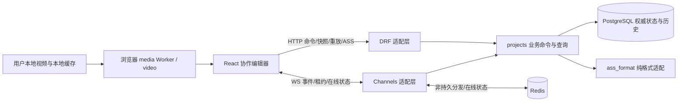
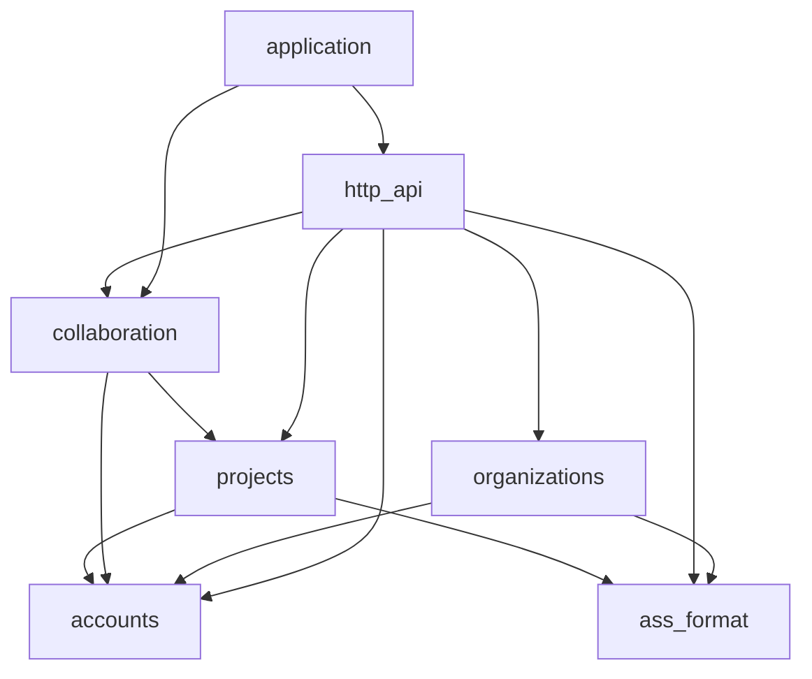

# CueRelay 架构入口

状态：2026-10-22 已实现首个 Coding Task 的本地媒体 / ASS 验证台；自动检查和合成浏览器检查见 [实验记录](experiments/media-ass.md)。真实片源制作验收尚未完成。根目录 `AGENTS.md` 已归档用户提供的原文。

Planning Review 已结束，已确认默认见 [产品决策](product.md) 与 [D-R1](decisions/0001-initial-architecture.md#d-r1)。当前落地媒体 / ASS 本地工作区及固定方案 A 的用户/多组织/个人设置切片。下文完整项目协作结构仍是未来设计，不代表已实现。

2026-10-23 已实现 [用户系统与固定权限方案 A](user-system.md)：PostgreSQL、自定义 User、Django Session/CSRF、多组织 organizer/member、个人快捷键及内存编辑保护。账号/组织切片后已增量接入 [项目面板](projects.md)：项目初始化、固定视频基准、归档和手动字幕快照保存；验收见 [用户系统记录](experiments/user-system.md)。

2026-10-24 通用编辑操作：新增账号级鼠标边界点击开关（个人设置「快捷键」栏，随「保存快捷键」持久化）及四个默认空绑定动作，沿用现有布局、seek、10ms 精度和快捷键过滤。`ass_format.splitting` 统一执行纯快照拆分；项目 `split_cue` 复用 `save_document` 的权限/事务/revision 路径，一次保存完整快照；本地工作区走无持久化转换接口。两条新 UUID 用可选 source_id 保留原始 ASS 元数据。按用户确认，本次不实现原仓库尚不存在的编辑锁、审核、修改历史和实时推送。完整规则、API 与限制见 [编辑操作契约](editing-operations.md)。

2026-10-24 样式管理 A 阶段：组织模板表与项目 v2 样式快照、稳定 style_id、具名原子操作、复制导入/批量属性修改、脚本设置及受限等比适配已实现。复用项目 revision/权限/事务、原 ASS codec 和 JASSUB。组织设置增加模板库，项目设置和本地工作区组合样式面板与独立样本预览；未新增 WS、历史事件或审核系统。已确认范围、迁移/API/测试入口见 [样式管理](style-management.md)。

## 当前可运行入口

2026-10-24 实时 ASS 预览：`workspace-ui` 把当前文档及有效时间草稿交给 `ass-preview`，复用后端唯一 ASS 序列化器；JASSUB 2.5.23 在本地 Worker/WASM 叠加到现有 video。120ms 合并、过期响应隔离、串行 Track 更新、暂停强制重绘、全屏及同源 Noto Sans SC fallback 见 [预览模块](../frontend/src/ass-preview/README.md)，实测见 [验证记录](experiments/ass-preview.md)。没有新增自动保存或协作传输；Style 写接口见下述样式管理契约，项目远端修改仍经显式重载接受。

2026-10-23 音频阶段 B–D 已接入正式打轴页：`media/audio` 负责本地 MP4 分段 PCM、Worker 内的峰值 / Hann STFT 分析与 32 MiB LRU；`workspace-ui/audio-timeline` 负责 canvas、共享秒坐标视窗和交互。LocalVideoPlayer 通过 onFile 显式发布同一个 File，字幕状态仍归 EditorWorkbench。视频是唯一时间与声音源。Waveform / Spectrum 切换复用 PCM，不改变缩放、平移或播放头。边界拖动 / 键盘只更新工作区的 changeTimeDraft，commitAndAdvance 统一校验、提交并选择下一条。阶段 A 的 `experiments/audio-probe.html`、生命周期探针只用于开发。契约见 [audio README](../frontend/src/media/audio/README.md)，B–D 实测见 [时间轴记录](experiments/audio-timeline.md)，大文件边界见 [A 记录](experiments/local-audio.md)。

显示模式为 accounts.PersonalSettings 的账号偏好，默认 Spectrum；入口位于个人设置的「音频显示」，工作区不显示切换按钮。App 通过既有设置加载/重新聚焦/30 秒检查取得偏好，以 audioMode 传给 EditorWorkbench，再传 AudioTimeline 的受控 mode；两者不持有另一份模式状态，也不拥有偏好持久化。保存设置不替换保留的编辑器或 File，因此不重置字幕、时间草稿、视频、视窗或 PCM 缓存。原音频工具栏已移除，空间交给画布；普通滚轮平移、Shift+滚轮以指针为锚缩放（兼容浏览器将 Shift 滚轮改为水平 delta 的情况）。

红色播放头支持拖动定位：AudioTimeline 在现有 pointer capture 中区分 pan / seek，复用既有 AudioViewport、timeAtX 和 onSeek；不直接持有或改写视频播放状态。定位拖动期间冻结视窗，字幕边界重叠时保留编辑优先级；边缘判断允许媒体定位的微秒舍入，契约见时间轴 README。

2026-10-24 Vertical Zoom：`AudioTimeline` 本地持有独立 verticalZoom（默认 1.0，0.5–4.0），右侧原生竖直滑块实时调整 / 双击复位。Spectrum 在 UI 层对归一化 dB 能量应用 `e ** (1 / verticalZoom)` 后查既有三种状态色表；Waveform 缩放并约束峰值显示高度。每 tile 复用目标高度的量化能量、共享 ImageData 和最多三张当前 zoom 的 canvas，RAF 合并绘制，不重新解码 / FFT、不积累历史缩放图像。Worker、字幕、播放和坐标契约不变；状态随组件实例保留，不持久化到账号。实现与验证见 [时间轴 README](../frontend/src/workspace-ui/audio-timeline/README.md) 和 [垂直缩放记录](experiments/vertical-zoom.md)。

Spectrum 本体左键单击设置入点、右键设置出点，统一经 onBoundaryChange → changeTimeDraft 更新现有草稿，吸附 10ms。只在文档就绪、canEdit 通过、工作区可见、快捷键未暂停且无转换 / 待确认导入时提供回调；G / Enter 调用 commitAndAdvance。图内点击定时不 seek 视频，标尺和 Waveform 单击定位、播放头 / 边界拖动及左键拖动平移继续保留。标尺高度由 draw-ruler 导出的常量与绘制共用，没有新增时间状态或字幕副本。

`workspace-ui/cue-defaults.ts` 在本地工作区加载或导入无行 ASS 时补一条 0–2 秒空文本字幕并选中，样式为文档第一项；已有行不改动。默认 2000ms 常量与连续打轴共用，后端空文档接口保持原样。EditorWorkbench 的 hasEdits 仅在真实时间草稿、文本 / 样式编辑、提交或删除时设为 true；未修改的默认行不触发离页 / 导入替换确认，导入标记仍受保护。删空不会强制重新插入，刷新后才重新初始化。

空文档的时间草稿也传给 AudioTimeline，不再以已有选中行作为绘制入 / 出点的前提；删空后的 0 / 0 草稿可保留，只有提交才校验区间。工作区同时显式传入只读 cues；`AudioCueIntervals.tsx` 显示视窗内其他行的橙色入点 / 紫色出点虚线和底线，不持有历史副本、没有点击 / 拖动命中区。`cue-intervals.intervalPosition` / xAtTime 同时投影 Canvas 区间裁剪与 DOM 边界，裁剪处不生成假端点。当前行保留橙 / 紫可编辑实线与文字；BoundaryCaps 为两类边界提供共用的上下朝内三角，不增加命中区。`viewport.revealInterval` 仅在所选区间超出视窗时移动视窗，连续提交到已可见的下一条不会挤走前文。

边界拖动按鼠标键区分：入点左键，出点右键；出点不拦截左键，因此共享时间点可直接左击设置下一条的入点草稿。边界的右键菜单只阻止默认菜单，不重复设置时间；两种拖动都沿用原草稿与校验。

连续打轴由 `workspace-ui/commit-timing.ts` 纯函数负责：校验当前时间草稿、写回当前行，选择已有下一行；末尾才新增空文本行，起点等于本次出点、时长 2000ms、样式继承当前行。“创建新行”和“循环试听 / 提交并下一条”按钮行均已移除，保留 G / Enter 提交。页面默认行直接作为当前行写回；删除所有行后再从空草稿提交仍可创建当前行和下一条。非空文档未选择行时要求先选择，不隐式覆盖或追加。`subtitle-model/cue-order.ts` 是 CueTable、提交导航与项目设置共同的时间排序规则，下一条取自提交前显示顺序，原始 ASS 事件数组顺序保持。新增行不会按视频时长截断；若超出既有 10 小时支持范围则整次操作拒绝，保留草稿与文档。测试见 cue-defaults / commit-timing 与 `browser-tests/commit-timing-checks.mjs`。

delete-row 已纳入个人快捷键设置，默认 Ctrl / Cmd + Delete（也接受 Backspace）；共享 JSON 唯一声明四个默认别名，覆盖替换全部默认、空列表禁用、删除覆盖恢复默认，不再有固定删行分支。只有此动作额外接受 Ctrl/Meta+Delete/Backspace；输入框 / IME / 重复保护复用 allowsShortcutFocus；所有动作按共享默认与个人覆盖精确匹配修饰键，保持原始 KeyboardEvent，不复制其原型属性。按钮与快捷键统一调用 `delete-cue.ts`，删除后选显示顺序的下一行、没有下一行则选上一行，删空时清除选择并重置 0 / 0 草稿；不定位或截断视频，不改变剩余 ASS 事件顺序。单元回归见 delete-cue / timing-shortcuts，真实浏览器同时验证输入框和待确认导入不能被删行快捷键穿透。

时间轴顶部标尺复现 Aegisub 3.2.2 的八档刻度和时间前缀省略：`ruler.ts` 计算可见绝对时间刻度 / 测量避让，`draw-ruler.ts` 在既有 canvas 顶部绘制；`viewport.xAtTime` 统一标尺、频谱与覆盖线坐标。没有第二套视窗或滚动状态，缩放锚点和编辑交互继续由 AudioTimeline 持有。精确契约与测试入口见 [时间轴 README](../frontend/src/workspace-ui/audio-timeline/README.md#aegisub-标尺契约)。

频谱显示沿用提取 / Hann STFT 和共享坐标，采用线性 0..Nyquist 与固定 -80..0dBFS 峰值幅度标度。`media/audio/spectrum.ts` 唯一拥有频带 / 能量契约；UI 的 `spectrum-pixels.ts` 负责峰值保留的纵向重采样与 normal / inactive / active 色表。normal 保留黑蓝青白；后两者参考 Aegisub Icy Blue HSL 参数，直接映射同一能量，而非叠加透明蓝色。draw-audio 先 normal，再按其他行联合区域重绘 inactive，最后当前时间草稿 active，重叠不累加；更改区间触发重绘，不触发分析 / 解码。draw-spectrum 的组件级 WeakMap 为每个 tile / 色表缓存一张目标物理高度图像，按需处理相交区域，DPR 变化时重建。波形共用区间背景，峰值绘制不变。深色样式限定音频区域；不更改全站主题、播放和字幕编辑入口。调查与验证见 [频谱显示记录](experiments/spectrum-display.md) 和 [区间配色记录](experiments/interval-rendering.md)。

运行和全部验证命令见 [README](../README.md)。当前已有账号/组织数据库、迁移和 Session 认证；已有项目快照存储，尚无 WebSocket 或实时协作。

- `backend/manage.py`、`application/{settings,urls,asgi}.py`：Django/DRF 组合根，PostgreSQL 与环境配置，默认受保护接口；`application/admin.py` 显式注册 dev 专用 Admin，`identity_admin.py` 协调账号停用与组织约束。
- `accounts`：AbstractUser（username 同时用于登录和显示）、PersonalSettings、本人密码/设置服务；AccountBackend + LoginAttempt 以 PostgreSQL 行锁共享账号登录限制，统一密码验证器设置 15–1024 字符。见 [局部契约](../backend/accounts/README.md) 与 [安全/部署契约](account-security.md)。不依赖 organizations 或 HTTP。
- `organizations`：Organization、OrganizationMembership、固定角色鉴权、成员写入与事务约束，见 [局部契约](../backend/organizations/README.md)。依赖 accounts 的公开 User 身份及 ass_format 的纯样式校验；目标用户锁在组织锁之前，多组织按 id 锁定，维护至少一名活动 organizer。
- `http_api/identity_views.py`：Session/登录/退出/本人只读身份、密码/设置、组织及成员 JSON 适配。身份、成员和项目操作者统一显示 username，无自定义显示名；改密要求两份新密码一致。organizer 不能移除或降级其他 organizer，由 organizations.services 在组织锁内重查；dev 仍受最后活动 organizer 约束。Django CSRF 中间件保护匿名登录和全部写入；身份从 Session 获取，白名单拒绝未知字段。与纯格式公开接口分离。
- `http_api/auth_security.py`：在 CSRF 前限制现有密码入口的请求体和 Admin 密码长度；将认证 backend 的重试秒数转换为 API/Admin 共用的 429 JSON/Retry-After。实际密码校验和账号计数只由 accounts 拥有，不再使用进程内 IP 缓存。
- `projects`：组织项目生命周期、固定媒体基准、有限 ASS 快照、revision 冲突保护，写入锁操作者 User → Organization → Project；契约见 [projects README](../backend/projects/README.md)，HTTP 适配在 `http_api/project_views.py`。
- `project-ui/{ProjectsPanel,ProjectForm,ProjectSettingsPage}.tsx`：列表、搜索/分页、创建弹窗和独立项目设置页。App 组合 navigation 和 app-workspace，项目保存/重载经明确接口，见 [project-ui README](../frontend/src/project-ui/README.md)。
- `media/{file-hash,file-hash.worker,media-manifest}.ts`：本地完整 SHA-256 与可播放/时长检查，Worker 分块且可取消；不读账号/组织、不上传视频。
- `shared/timing-shortcuts.json`：后端和前端共同读取的默认键位唯一来源，个人设置仅保存覆盖。
- `ass_format`：纯格式公共入口 `parse_ass` / `serialize_ass` / `empty_document`，原始行锚点适配隔离 pysubs2 保留局限，见 [局部契约](../backend/ass_format/README.md)。
- `http_api/ass_views.py`：`GET /api/ass/empty`、`POST /api/ass/import {source}` 返回 `{document}`；`POST /api/ass/export {document}` 返回 ASS 文本。400 为请求契约错误，422 为不支持或非法内容（issues），413 为请求过大；无持久副作用。
- `frontend/src/main.tsx → App.tsx → workspace-ui/EditorWorkbench.tsx`：EditorWorkbench 的页面内存唯一拥有字幕状态和选中区间；App/account-ui/project-ui 编排 Session、组织、项目面板、设置和弹窗，navigation 统一页面 URL/历史，app-workspace 持有保留实例和项目加载，经 WorkbenchHandle 查询本地内容/导出，经 header 与 shortcutsPaused 接口组合工作区，不让会话检查卸载编辑器；通过 `project-data/ass-api.ts` 显式导入和导出字幕。前端不解析或生成 ASS。已移除原件 / 被拒原件下载及其 File 状态；只保留成功导入标记用于原有离页保护，待确认导入的 File 仅在替换确认期间暂存。转换状态位于顶栏，不占独立文档栏。
- `media/LocalVideoPlayer.tsx`、`playback.ts`：本地 File/Object URL 生命周期、时间契约、焦点与 IME 快捷键过滤；不包含定位测量工具。LocalVideoPlayer 拥有视频下方的导入控件和媒体 File / 固定状态，通过 `controls: ReactNode` 接收 workspace-ui 提供的播放按钮与时钟，同一行显示；没有视频标题 / 文件名栏。导入使用真实按钮同步触发 hidden 文件 input，避免透明原生控件覆盖按钮时出现默认文件名提示；鼠标和键盘都可选片，取消不改变已选视频，校验/固定时同时禁用按钮和 input。
- LocalVideoPlayer 关闭原生 controls，在画面外下方渲染原生 range 进度条，接收受控 currentTime / duration（毫秒）和 onSeek，不持有另一份播放时间，不添加音量按钮。EditorWorkbench 的 seekPlayback 为进度条与 AudioTimeline 共用跳转入口，取消旧试听、调用 seekVideo 并立即同步显示时间，保留原播放 / 暂停状态，不修改字幕或时间草稿。验证见 [视频进度条记录](experiments/video-progress.md)。
- 2026-10-25 视频全屏：LocalVideoPlayer 使用 16px SVG 图标 / 28px 按钮，监听 Fullscreen API 更新进入/退出图标、title 和 aria-pressed；仍只全屏 video/canvas 所在 stage。EditorWorkbench 在本视频进入全屏时同步取消现有试听观察器（清理句柄保存在 ref），保留时间和播放/暂停状态。全屏中的无修饰 Space 优先普通播放/暂停，允许 video/全屏按钮焦点并阻止按钮再次激活，保留输入框/IME/重复/弹窗/工作区可见性保护；不读取时间草稿或个人试听键位。退出全屏不恢复旧试听，普通工作区恢复个人配置下的 Space/S 行为。未改后端、字幕状态或预览链路；浏览器回归见 `frontend/browser-tests/fullscreen-playback.mjs`。
- `workspace-ui/CueTable.tsx`：按时间展示行号、入、出、CPS、style、字幕文本，点击行号/文本选择字幕，不提供独立定位列；空文本以弱化色斜体 `（empty）` 占位，不写回正文。`cue-cps.ts` 只从已应用时间和当前文本派生每秒字符数，不进入 DTO 或保存数据；按 Unicode 字素统计并忽略 ASS 块、空白、标点，整数向下取整（参考 [Aegisub 网格](https://github.com/TypesettingTools/Aegisub/blob/master/src/grid_column.cpp) 与[默认计数选项](https://github.com/TypesettingTools/Aegisub/blob/master/src/libresrc/default_config.json)）。非正/非有限时长显示 `—`，不复制 Aegisub 的短时长隐藏或告警配色。回归见 cue-cps.test.ts；表格文本列占剩余宽度。
- `workspace-ui/cue-column-widths.ts` 定义字幕列默认值、可调范围和表格最小宽度（保留 180px 文本空间）；CueTable 用 colgroup/fixed layout 应用宽度并在实例内持有状态。入/出默认 100px、CPS 44px、style 88px，行号固定 44px。`CueColumnResizeHandle` 仅处理表头右边界的 Pointer Capture 与键盘动作；支持取消/失去捕获、双击默认、方向键 8px/Shift 24px 与 Home/End，宽度由 CueTable 统一约束。调宽不更换字幕或媒体实例，不写 Storage/DTO；同页历史保留实例时保留列宽，刷新或更换实例恢复默认。窄屏在表格内滚动，不挤压最后一列；验证见 [字幕表格记录](experiments/cue-table.md)。
- `shared/timing-shortcuts.json` 唯一声明可配置默认键位，`workspace-ui/timing-shortcuts.ts` 负责全部动作（含删行）的个人覆盖、校验和分派；默认 G / Enter 提交并下一条，S / Space 单次播放选区，Q / W 播放入点前 / 出点后 500ms，E / D 播放选区开头 / 结尾最多 500ms。EditorWorkbench 复用当前时间草稿和 `commitAndAdvance`，通过单一 keydown 监听器分派；I/O/J/K/U/P/L/N 不再绑定，过时提示及时间采集 / 微调按钮已移除。`media/playback.ts` 的 `auditionRange` 只截断试听范围到媒体边界，空交集不播放，不改字幕时间；`watchPlaybackRange` 共用现有播放器观察区间，EditorWorkbench 只保留一个单次试听状态，切换或结束时清理旧观察器。循环按钮及其不可达的 startLoop 编排已移除，底层公共区间播放接口未改动。映射、焦点 / IME、范围和播放生命周期回归见 timing-shortcuts / playback / range-playback 测试；本次验证见 [快捷键验收记录](experiments/aegisub-shortcuts.md)。
- `workspace-ui/TimePointControl.tsx`：入点 / 出点的同构输入控件，仅接收值与 onChange，区间状态和校验仍由 EditorWorkbench 编排；两组“当前时间 / −10ms / +10ms”按钮及其采集 / 微调回调已移除，边界滑块仍支持方向键微调。EditorWorkbench 的 main 只在鼠标点击普通按钮后接收焦点（tabIndex=-1、preventScroll），避免 Enter / Space 再次激活刚点击的按钮；键盘 / Tab 激活继续保留按钮原生行为，边界 role=slider 不转移焦点。AudioTimeline 左 / 右键操作显式聚焦 stage，右键设置出点不再遗留输入框焦点。`allowsShortcutFocus` 允许 slider 上的 Enter / Space，保留输入框 / 视频控件 / IME、修饰键、重复及 defaultPrevented 过滤；普通键盘焦点按钮 / 链接仍保留原生激活。回归见 `browser-tests/shortcut-focus-checks.mjs`。页面采用紧凑工具栏、视频与字幕编辑双栏、独立字幕表；不改变字幕数据或格式模块边界。
- `workspace-ui/ResizableWorkbench.tsx` 拥有桌面分栏比例、ResizeObserver 尺寸测量和 Pointer Capture 生命周期；接收 `media` / `editor` ReactNode，不访问字幕 DTO 或媒体内部状态。默认左栏比例 42%（901–1100px 为 36%），通过中间 16px 命中区拖动调整；方向键微调，Shift 加大步长，Home / End 到边界，双击恢复默认。比例仅存于当前组件状态，窗口变化时重新约束，拖动不重建 video。
- `workspace-ui/workbench-sizing.ts` 唯一负责宽度边界：媒体栏最低 300px、编辑栏最低 480px，视频最大宽度由上方区域可用高度和 16:9 决定，避免继续扩宽后视频大小不再变化。空间不足时以保留编辑区为先。CSS 的 `--divider-width` / `--video-controls-space` / `--default-media-share` 是布局测量契约，避免 JS 复制间距和断点默认值；边界回归见同目录 sizing 测试。
- 工作区桌面布局由窗口高度约束：上方约 54% 视口高度（400–560px，可在短窗口中收缩），右侧为音频时间轴和时间 / 样式 / 文本编辑；下方字幕表填满剩余高度并独立滚动、固定表头。音频支持峰值波形、频谱、0.5–60 秒视窗、滚轮平移 / Shift+滚轮缩放 / 拖动平移、点击定位和字幕草稿边界显示，不包含语音识别。样式下拉框按 name 展示、以稳定 style_id 修改当前行引用；样式定义由独立 style-ui 面板经具名服务操作。
- `styles.css` 的 `.video-stage` 始终保持 16:9，以媒体栏宽度和可用高度共同限制尺寸；`.media-panel` 提供尺寸容器，预留 96px 给独立进度条、导入 / 播放 / 时钟 / 字幕开关共用控制栏及画面外预览状态提示，禁止 flex 将视频框压扁。不同画幅片源通过 object-fit: contain 等比显示。快捷键说明展开项已删除，快捷键本身保留；节省的编辑器高度由音频区 flex 增长承接。编辑器内部滚动，长错误不挤走字幕表。900px 以下隐藏分隔线并恢复页面纵向滚动，依次展示紧凑视频 / 播放控制、音频 / 编辑器和字幕表，返回桌面时复用用户比例和同一个 video。
- `ass-preview` 已恢复实时 ASS 渲染，核心 hook 接收 workspace-ui 注入的 serialize 函数；StyleSamplePreview 组合组件直接使用 project-data.exportAss，统一复用后端序列化。LocalVideoPlayer 通过 controls/status 插槽组合开关和提示，全屏包含 video/canvas；不增加媒体层对渲染器的依赖。字体管理、定位测量和手输时间跳转仍未提供；保留按字幕行定位和区间试听所需的内部 seek。`CueTable.tsx` 的时间显示排序不修改 ASS 事件顺序。

当前后端依赖是 `application → http_api → {accounts, organizations, projects, ass_format}`，`application → {accounts, organizations}` 负责 Admin 协调，`projects → {organizations, accounts, ass_format}`，`organizations → {accounts, ass_format}`，`ass_format → pysubs2`；accounts/ass_format/media 不反向感知组织。前端 `App → {account-ui, project-ui, workspace-ui, style-ui, navigation, app-workspace}`，`{project-ui, account-ui/SettingsPage} → navigation`，`app-workspace → {project-data, contracts, navigation 路由类型}`，`project-ui/workspace-ui → {project-data, media}`、`workspace-ui → ass-preview → {contracts, project-data, JASSUB}`，`project-data` / `workspace-ui` / `CueTable` 引用 `contracts`，`{workspace-ui, project-ui} → style-ui → {project-data, ass-preview, account-ui/Modal}`；App 通过 SettingsPage 的 ReactNode 插槽组合组织库，style-ui 不访问工作区内部。底层不反向依赖 UI。媒体字节不会进入转换 DTO。导出使用后端序列化器。时间采集吸附 10ms，不宣称可靠逐帧。编辑导出保留受支持语义。

## 1. 阅读路径与文档所有权

| 文档 | 唯一负责的问题 |
| --- | --- |
| [product.md](product.md) | 为谁做、必须做什么、P0/P1/P2、成功标准与待确认产品假设 |
| [domain-model.md](domain-model.md) | 实体、时间/版本含义、权限、状态派生、ASS 可编辑契约与结构性操作 |
| [invariants.md](invariants.md) | 必须始终成立的业务约束及验证责任 |
| [realtime-protocol.md](realtime-protocol.md) | 命令、确认、租约、游标、重放、冲突与重连的传输语义 |
| [milestones.md](milestones.md) | 实验门槛、开发顺序、任务与验收 |
| [0001 初始决策](decisions/0001-initial-architecture.md) | 方案选择的理由、替代方案、代价和重新评估条件 |

新任务先定位涉及的不变量、命令及所属模块，再读相应测试。当前实际入口见上节；下文尚未在入口列出的协作模块均为将来实施建议。

## 2. 整体方案

推荐保留 Python + Django/DRF/Channels、PostgreSQL、Redis，以及 React + TypeScript + Vite 的模块化单体。Django 一个 ASGI 应用服务，可按实际容量运行多个进程；不是微服务。HTTP 承担持久命令和查询，WS 承担事件、在线状态和租约交互；两种入口调用同一个项目业务接口。

没有媒体字节从浏览器进入后端的箭头。ASS 是允许上传的小型字幕文档，与本地视频不同。前端渲染器可消费字幕与本地视频，不得自动查找远程字体、上传诊断帧或调用云端解码。

## 3. 后端模块与依赖

P0 采用少量实际责任模块，而不是为每个候选实体建立一个 Django app。尤其把行、租约、审核、样式放在同一项目业务边界中，避免拆成互相依赖的 subtitles/reviews/locks 服务。

| 建议模块 | 所有权与公共接口 | 禁止依赖 |
| --- | --- | --- |
| accounts | 已实现 User、Session 身份/本人密码和设置；不建立全局工种体系 | 不依赖组织、项目、传输层 |
| organizations | 已实现多组织、固定角色、组织模板与鉴权/最后活动管理者约束 | 依赖 accounts 和 ass_format 公开纯校验；停用协调在 application |
| ass_format | 纯解析/预检/序列化/文本子集验证，输入字节或明确 DTO，输出文档数据/问题列表；无 ORM/网络副作用 | 不依赖 Django 项目模型、React、Redis |
| projects | 项目/成员/媒体基准/样式/字幕/审核/租约/历史/回执的唯一数据所有者；公开 `commands` 和 `queries` 的具名操作及结果 DTO | 不依赖 HTTP、WS、Redis 或前端；不自行广播 |
| http_api | 身份提取、CSRF、请求验证、命令映射、快照/重放/导入导出响应；提交后触发通知 | 不访问 projects 私有 ORM 模型，不重新实现审核/锁规则 |
| collaboration | Channels 连接、Origin 检查、逐次鉴权、事件发送、水位轮询、租约传输和 Redis 在线状态；广播只发送安全投影 | 不直接修改项目模型，不把 Redis 当租约或历史来源 |
| application | ASGI/路由/配置及组合根；连接 HTTP 提交回调与 collaboration 通知函数 | 业务模块不反向依赖此层 |

箭头表示“允许导入”，不表示每个文件必须导入。http_api → collaboration 仅用于提交后的通知入口，该入口不导入 http_api；projects 返回已提交事件信息，业务层不反向调用通知。accounts/ass_format 是底层，organizations 位于 accounts 上层，所有依赖保持无环。Django 设置由组合根安装各模块，不算业务逆向导入。

首个 M1 验证任务的无持久副作用 ASS 转换接口可直接调用 ass_format 公开接口；正式项目导入、保存与导出仍由 projects 执行权限、快照及事务规则。

projects 内按具体职责组织聚焦文件：模型定义、权限、时间与文本校验、行命令、审核命令、租约命令、项目/样式命令、导入导出编排、查询和日志记录。公开入口与固定事务顺序放在局部 README；内部命令可共享少量事务/鉴权帮助函数，但不互相循环调用。业务操作直接使用 ORM，不机械引入 Repository/Factory、通用事件总线或多层 Service。

其他模块只通过公开命令/查询读取数据，即便同处一个进程也不导入私有 models。`projects` 是一个项目编辑业务模块，不是承载登录、媒体解码、UI 或任意共享工具的杂物箱；将来出现独立生命周期再按证据提取。

## 4. 前端模块与数据所有权

下表包含未来协作结构；ass-preview 已实现本地实时预览，project-data 的 WS/协作状态等仍是未来设计。当前依赖以文首可运行入口为准。

| 模块 | 职责与接口 |
| --- | --- |
| contracts | HTTP/WS 的类型、错误类别与无副作用数据结构；不把后端 ORM 模型自动当成客户端模型 |
| project-data | HTTP/WS 客户端、服务器副本、连续序号应用、回执关联与重同步；独立草稿身份/代次、未决命令持久化和恢复也由此模块负责，规则见协议第 3/5 节；不依赖 UI 或媒体，不引入通用离线队列 |
| media | 文件选择、本地校验 Worker、播放/跳转/试听、未来峰值缓存；只输出播放接口、验证状态和允许的元数据，禁止依赖网络客户端 |
| ass-preview | 本地字幕渲染与字体能力提示；接收字幕快照/本地 video 句柄，第三方引擎封装在这里，不承担保存和业务权限 |
| workspace-ui | 字幕列表、时间输入、翻译/审核队列、样式管理、历史视图和冲突界面；组合 project-data/media/ass-preview；快捷键只在正确焦点与非 IME composition 时工作 |
| app | 登录与路由、页面组合、会话生命周期和全局错误出口 |

依赖是 `app → workspace-ui → {project-data,media,ass-preview} → contracts`，app 也可直接组合底层公共接口。底层模块不引用页面组件。media 不读取全局 store；UI 用显式参数把当前行/视频位置连接起来。共享服务器状态与当前选中行、播放时间、未提交草稿分别管理，远端更新不能抹掉本地输入。

最初只用足够的 React 状态管理与一个明确的服务器副本；不同时引入多个争夺字幕权威的缓存库。列表窗口化、Worker 和渲染器按真实压力选择；UI 套件待交互原型后确定，不 fork 完整字幕编辑器。

## 5. 核心调用路径

### 保存一行

1. UI 在媒体验证通过后请求整行租约；project-data 保存其会话与 token。用户输入留在本地草稿。
2. 停输/周期生成冻结的 HTTP 命令，先在本地持久化命令 ID、请求、预期版本及草稿 ID/代次，再发送；落盘失败不发送。服务端限制可写字段并调用统一命令。其他持久命令同样遵循此发送前约束。
3. projects 开短事务，锁 Project，重查权限和幂等回执，再查租约/行版本/输入约束；写数据、序号、历史和成功回执，原子提交。
4. HTTP 成功响应给调用者；适配层在提交后尝试通知 collaboration，经 Redis 分发已提交事件。通知失败不回滚已提交保存，也不把它报告成“未保存”。
5. 其他窗口按连续序号应用；丢消息由数据库重放补齐。发起窗口用回执确认对应草稿代次，同时也按序处理项目事件，不能跳游标。

审核、成员修改、样式修改、删除采用同样的事务入口。取锁/续期也走 projects 的短事务，但不改变 project_seq。具体前置条件与失败恢复由协议统一定义。

### 读取、导入与导出

P0 一致快照采用同一 Project 事务锁，在锁内读取完整的项目状态并复制为 DTO，然后释放锁再编码/传输。项目初始化事务成功后，所有项目写入都取同一锁，保证不会混合多个时点；这是规模受限的简单方案，不应在锁内进行文件格式化或网络发送。若 5,000 行压力导致锁时间超预算，再评估 PostgreSQL 一致性读事务，不先引入快照服务。

ASS 预检在事务外执行并有大小/耗时限制，失败文件不持久化，原件仍由本地 File 提供；成功提交时重新校验原件摘要、项目空状态、权限、预期序号与样式版本，并将原件和业务数据一次写入或全部回滚。导出先取带 project_seq 的一致快照，再由 ass_format 生成文件。已导入原件有独立受权下载入口，不能被工作稿导出替代。

## 6. 持久化、同步与运维边界

PostgreSQL 保存所有业务状态、EditLease、版本、ChangeEvent/成功回执、成功导入的受限 ASS 原件。Redis 只承担 Channels 消息分发及可丢失在线状态；重启后在线状态可重新登记，租约不会凭空变成可覆盖权限。Channels 的异步消费者通过同步事务适配调用 projects，整个事务留在一个同步执行单元内，不能在持有数据库锁时跨 await 等待网络。

推荐每项目短事务串行写入：它把项目序号、权限、审核与样式竞态统一到一个锁顺序，适合初期 3–10 人的小组。代价是热点项目吞吐上限与大批量操作阻塞，必须通过 S4 压测；不能在未测量时承诺无限扩展。

Channels 分发可丢失组消息，因此 WS 不是可靠日志。提交后广播只提供低延迟；消费者按固定周期从数据库查询水位/权限，客户端可通过 HTTP 独立校验并重放。它也覆盖“提交后进程在广播前崩溃”和“最后一条消息丢失”。P0 不新增可靠消息队列/outbox worker；若后来要求更严格推送时延或规模，再明确记录决策。依据：[Channels channel layer 规范](https://channels.readthedocs.io/en/stable/channel_layer_spec.html)、[Django 提交后回调](https://docs.djangoproject.com/en/5.2/topics/db/transactions/#performing-actions-after-commit)。

Alpha 期间保留项目全部业务历史与成功命令回执，不截断审计；重放可以设有界窗口，过旧客户端走全量快照。未来留存/脱敏策略需保留幂等安全边界。日志只记录命令 ID、序号、错误与必要耗时，不默认记录字幕全文/租约 token/媒体路径。备份必须涵盖数据库、ASS 原件和恢复所需配置，恢复后客户端强制重新同步和取锁。

备份恢复可能生成与旧缓存序号相同的另一段历史，水位大小不能识别它。[D-R1](decisions/0001-initial-architecture.md#d-r1) 已选择显式恢复代号；字段及切换细节推迟到相关恢复机制开发阶段，不作为首个媒体/ASS 验证任务的前置工作。普通应用进程/Redis 重启不等同于数据库回退。

## 7. 权限与安全边界

当前切片以 [user-system](user-system.md) 为权限权威：站点 dev=is_superuser，组织固定 organizer/member。普通成员不按打轴/翻译/校对限制；不实现动态 RBAC 或项目级权限矩阵。以下 WS/项目安全语义仅为后续方向。

推荐同源部署与 Django session cookie（HttpOnly、Secure、适当 SameSite），HTTP 写请求校验 CSRF；WS 校验可信 Origin 与认证会话，握手通过不等于永久授权。每次命令、重放和数据发送都重查项目权限；活动连接定期复核会话/成员关系，撤权信号只是加速，不能依赖可能丢失的广播完成撤权。

客户端不被视为可信：时间、样式引用、可编辑字段、review 绑定、项目归属和版本全部在服务端验证。租约 token 是私密凭证，事件里只展示占用者与到期提示。字幕/ASS 作为不可信文本；HTML 转义，格式解析限制大小/行数/复杂度，渲染器不执行输入、不自动请求任意外部资源。导入许可不等于允许访问其中的本地路径。

媒体摘要可能暴露文件可识别性，仅成员可读，不建立全局可枚举的文件查询。网络只允许产品规定的元数据，字体默认随应用合法分发或用户本地选择；未解决字体授权/缺字提示前不能承诺各设备显示完全相同。

## 8. 技术事实、候选组件与验证状态

下列资料于 2026-10-22 查阅；它们说明能力/限制，不是本项目实验结果。实现时重新确认具体版本、维护状态、许可证及传递依赖，不在 Planning 阶段安装或锁定版本。

| 候选/事实 | 设计结论与来源 |
| --- | --- |
| 原生 video | currentTime 设置是寻址，不自动证明逐帧；requestVideoFrameCallback 的 mediaTime 可辅助观测实际帧。按 S1 实测，不能把 `1/fps` 加减等同 VFR 逐帧。[currentTime](https://developer.mozilla.org/en-US/docs/Web/API/HTMLMediaElement/currentTime)、[帧回调](https://developer.mozilla.org/en-US/docs/Web/API/HTMLVideoElement/requestVideoFrameCallback) |
| 容器与文件访问 | 扩展名不能决定编码可播放；标准选片作基线，持久句柄只做增强。[媒体容器说明](https://developer.mozilla.org/en-US/docs/Web/Media/Guides/Formats/Containers)、[File System API](https://developer.mozilla.org/en-US/docs/Web/API/File_System_API) |
| 增量哈希 | SubtleCrypto.digest 不接受流式输入；推荐 Worker 顺序读取固定大小块，交给增量 SHA-256，不能散列各块再拼接摘要充当文件 SHA-256。hash-wasm 是支持分块输入的候选，需核验实际发行包及许可证。[MDN digest](https://developer.mozilla.org/en-US/docs/Web/API/SubtleCrypto/digest)、[hash-wasm 官方仓库](https://github.com/Daninet/hash-wasm) |
| 波形 | wavesurfer.js（BSD-3-Clause 候选）可评估显示与区间交互，不能当作长视频低内存解码方案；官方说明大音频整段解码存在内存风险，须验证本地分段解码/峰值方案。[官方仓库及 FAQ](https://github.com/katspaugh/wavesurfer.js) |
| ASS 渲染 | 当前恢复并固定 JASSUB 2.5.23：本地 Worker/WASM、同源中文 fallback、实时 Track 更新、跨源隔离与单线程路径均已在 Chrome 合成实测。色彩及失败清理适配见预览模块；Safari/Firefox 仍待实测。wrapper、WASM 及传递依赖许可证不同，不能把整个发行包概括为 MIT，见实验记录。渲染能力不决定可编辑子集。[JASSUB](https://github.com/ThaUnknown/jassub)、[libass](https://github.com/libass/libass) |
| ASS 格式 | pysubs2（MIT）可作为解析/测试候选，但不能未验证就承担原始数据保真；通过 ass_format 隔离依赖，必要时为严格子集做小型保留适配。[官方文档](https://pysubs2.readthedocs.io/en/latest/) |
| Redis | 许可证与版本有关，不能把所有新版本都当成 BSD；M0 记录使用版本和许可路径。若不符合分发要求，再评估替代实现并实测 channels_redis，不能仅凭协议相似认定兼容。[Redis 许可证表](https://redis.io/legal/licenses/) |

## 9. 验证与后续维护

测试分层为纯格式/状态测试、PostgreSQL 事务竞争测试、HTTP/WS 契约与故障注入、浏览器端到端测试、真实用户打轴验收。按 [不变量](invariants.md) 建立测试索引，按 [里程碑](milestones.md) 把实时协作放到早期可测切片。所有数据修改入口都应被同一组业务测试覆盖，不为每种传输重复实现规则。

首个切片已建立格式 / HTTP 契约 / 时间与快捷键测试，执行结果见实验记录；当前只检查实际模块的依赖方向，未来协作事务和恢复验证尚未执行。每个任务更新涉及的公共接口与架构说明，只在出现实际职责分离需求时提取新模块。

## main / audio 集成约束

2026-10-23：用户选择 audio 精简打轴工作流（提交并下一行、末行续行，移除旧采集/微调/循环/创建按钮）。保留 main 的账号/组织、个人快捷键和项目保存契约。Ctrl/Cmd+Delete/Backspace 为删行默认键；2026-10-24 已将 delete-row 纳入共享默认与个人设置覆盖表。shared 默认 commit 标签与实际行为一致。时间轴边界与提交/删除统一受 canEdit 保护，账号弹窗、隐藏或未验证片源时不能通过新交互修改草稿/字幕。

EditorWorkbench 的 `hasProtectedContent` 同时服务 beforeunload 与 WorkbenchHandle.hasContent：忙碌、待确认导入、媒体、项目、成功导入和用户编辑均受保护；未修改的自动默认首行不触发保护。默认首行只用于本地空文档/空 ASS 导入，打开项目不隐式改写已保存快照。集成状态与验证见 [执行记录](plans/main-audio-integration.md)。

## 前端导航与工作区生命周期

首页 `/` 保持根地址并展示当前可访问组织的项目列表，所有页面的 CueRelay 标题经 navigation.HomeLink 返回首页；EditorWorkbench 通过 title 插槽接收链接，保持 workspace-ui 不依赖 navigation。回首页只隐藏保留实例，后退或返回同工作区继续原稿。

2026-10-24：页面路径由 [navigation](../frontend/src/navigation/README.md) 唯一定义，采用原生 History API 和真实链接。App 根据目标资源是否替换当前实例编排保护；popstate 先恢复已提交历史条目，取消不改页面，确认重放原跨度。入口默认组织只用于 `/` 和 `/projects`，登录、刷新、直接访问不能覆盖显式组织/项目地址。工作区新开列表不改变本页 visible，同页返回列表才隐藏并暂停。

[app-workspace](../frontend/src/app-workspace/README.md) 负责单个保留实例、指定资源加载、创建 File 交接、保存/重载和归档/撤权观察。只有新项目/组织/账号或明确重载更换实例；同文档历史重返同项目和轮询只观察归档，不替换内存文档/revision。字幕与草稿仍归 EditorWorkbench，File/Object URL 归 LocalVideoPlayer，底层不依赖导航。没有 Storage 草稿或标签页同步。部署和验证见 [运行契约](frontend-deployment.md) 与 [导航记录](experiments/frontend-navigation.md)。

2026-10-24 设置页：项目列表右上角统一通过真实「设置」链接进入 `/settings` 或带组织上下文的个人设置地址；组织设置为 `/organizations/:organizationId/settings/organization`，旧 `/organizations/:organizationId/settings` 由既有入口规范化流程 replace 到新地址。`account-ui/SettingsPage` 只组合页面布局和 PersonalPanel / MembersPanel，App 保留账号、组织和退出保护编排；路由仍由 navigation 唯一定义。默认新开设置页不改变来源工作区；仅同文档历史浏览设置时隐藏并保留工作区，不清空字幕、File 或时间草稿；跨组织仍经原保护步骤，退出或移除自己也检查隐藏实例。列表不再提供「返回工作区」，同文档浏览器历史恢复原工作区，项目链接默认新开独立工作区。同文档内存保留与刷新/新标签页的独立状态边界不变。验证和限制见 [设置页记录](experiments/settings-pages.md)。

2026-10-24 标签页规则：navigation.RouteLink 默认新标签页并隔离 opener，HomeLink、设置页内个人/组织分类和错误页返回入口显式使用当前页；组织下拉仅出现在首页/项目列表。新建项目为列表本地操作：App 先处理保留工作区保护，再由 ProjectsPanel 打开 ProjectForm 单页弹窗，在本标签页选片、创建并 adopt 工作区；只有成功后才 push 项目 URL。旧创建地址规范到组织列表，无独立创建路由或跨窗口 File 交接。个人设置与本地工作区各增加带组织的上下文 URL，保证新 tab 不静默选回默认组织，保留原无组织入口。详情及验证见 [标签页记录](experiments/tab-navigation.md)。

2026-10-24 音频显示偏好：accounts.0004 添加 audio_display_mode（waveform/spectrum，默认 spectrum，数据库检查约束）。GET/PATCH /api/me/settings 在既有 Session/CSRF/账号一致性边界内扩展此字段；PATCH 接受非空字段子集，未提交字段保留，旧快捷键请求继续兼容。PersonalPanel 显式保存，App 沿用原有设置检查应用到已打开的工作区，无新增标签页通信/草稿存储。运行与验证见 [音频显示设置记录](experiments/audio-preferences.md)。

2026-10-24 创建弹窗修正：名称/说明和视频/字幕合并为同一表单；新建按钮留在当前列表，不新开 tab。Modal 的 cancel 处理只响应自身 target，文件 input 的冒泡取消不会关闭整份表单；真正 Escape/明确取消继续工作，忙碌时禁止误关。职责与验证见 [project-ui](../frontend/src/project-ui/README.md) 和 [创建表单记录](experiments/project-form.md)。

2026-10-24 项目设置页：项目列表移除打开/只读查看按钮，以项目名称进入工作区；管理操作直接显示项目设置及归档/恢复，不再折叠。navigation 新增 `/organizations/:organizationId/projects/:projectId/settings`，App 组合 project-ui/ProjectSettingsPage，设置页经 project-data 读取并更新名称/说明，保持 revision 冲突校验和显式刷新，不修改保留工作区的文档或 revision。ProjectForm 仅负责创建。沿用 organizer/dev 管理权限、归档只读及 RouteLink 新标签页规则；详情和浏览器回归见 [project-ui](../frontend/src/project-ui/README.md)。

2026-10-25 项目样式入口移至项目设置，项目工作区顶部移除入口，本地工作区保留。所有成员可进入设置管理活动项目样式；名称/说明仍仅 organizer/dev 修改，归档样式只读。ProjectSettingsPage 拥有一份 ProjectDetail/revision，元数据与样式串行写入，名称/说明草稿独立；样式操作使用已保存字幕，无需视频，不提交工作区草稿。已打开工作区保持旧文档/revision，保存正常冲突，显式重载后才采用新样式。app-workspace 不再提供样式回调。共享纯排序下移 subtitle-model，`{project-ui, workspace-ui} → subtitle-model → contracts`，避免项目设置依赖编辑器内部。验证见 [实施记录](plans/project-styles-in-settings.md)。

2026-10-26 现有项目的组织模板导入支持多选，通过 `import_many` 具名操作一次提交整批，复用 `projects.document_styles.import_templates` 与新建项目相同的模板快照校验/纯格式转换。沿用原事务、锁顺序和 revision 检查，只持久化一次；任一项失败整批不保存，前端保留选择与输入。旧单模板 import 继续兼容，未增加模块间依赖；API 与测试入口见 [样式管理](style-management.md)。

2026-10-26 审计修复：样式数值使用无上下文的精确 Decimal 边界比较；个人快捷键请求期间冻结输入/录制/恢复操作；API 代理 JSON 请求预算明确为 3MiB，ASS 仍限制 1MiB。projects 的只读 check_style_migration 复用纯格式升级验证器，固定 v1 历史夹具保护严格拒绝及整体回滚，不新增业务模块间依赖。修复决策、运行命令与结果见 [实施记录](plans/repository-audit-fixes-2026-10-26.md)。
