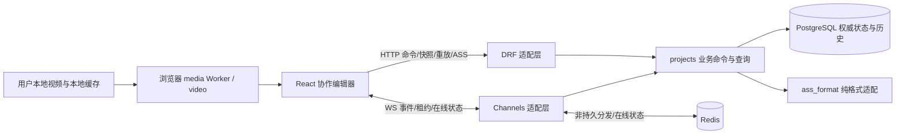
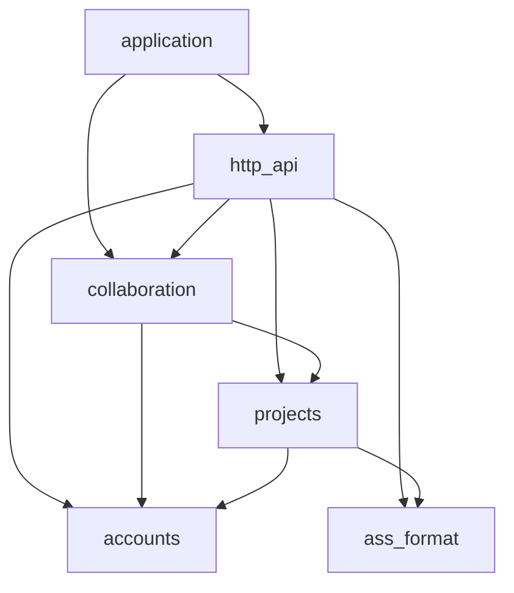

# CueRelay 架构入口

状态：2026-10-22 已实现首个 Coding Task 的本地媒体 / ASS 验证台；自动检查和合成浏览器检查见 [实验记录](experiments/media-ass.md)。真实片源制作验收尚未完成。根目录 `AGENTS.md` 已归档用户提供的原文。

Planning Review 已结束，已确认默认见 [产品决策](product.md) 与 [D-R1](decisions/0001-initial-architecture.md#d-r1)。本任务仅落地 M0/M1 的媒体 / ASS 有限切片，下文完整协作结构仍是未来设计，不代表已实现。未进入下一里程碑。

## 当前可运行入口

运行和全部验证命令见 [README](../README.md)。当前没有数据库、Models/Migrations、认证或 WebSocket。

- `backend/manage.py`、`application/{settings,urls,asgi}.py`：Django/DRF 本机组合根；`DATABASES = {}`，没有替代业务存储。
- `ass_format`：纯格式公共入口 `parse_ass` / `serialize_ass` / `empty_document`，原始行锚点适配隔离 pysubs2 保留局限，见 [局部契约](../backend/ass_format/README.md)。
- `http_api/ass_views.py`：`GET /api/ass/empty`、`POST /api/ass/import {source}` 返回 `{document}`；`POST /api/ass/export {document}` 返回 ASS 文本。400 为请求契约错误，422 为不支持或非法内容（issues），413 为请求过大；无持久副作用。
- `frontend/src/main.tsx → App.tsx → workspace-ui/EditorWorkbench.tsx`：页面内存唯一拥有字幕状态、原件 File 和选中区间；编排 `project-data/ass-api.ts` 的字幕转换请求与防过期预览更新。前端不解析或生成 ASS。
- `media/LocalVideoPlayer.tsx`、`playback.ts`：本地 File/Object URL 生命周期、时间契约、焦点与 IME 快捷键过滤；`SeekDiagnostics.tsx` 只测本地时钟和呈现帧元数据，不读取像素、不访问网络。
- `workspace-ui/TimePointControl.tsx`：入点 / 出点的同构展示控件，仅接收值及操作回调，区间状态和校验仍由 EditorWorkbench 编排。字母快捷键允许从按钮焦点继续使用；空格 / Enter 不接管按钮、链接或展开项的原生激活，输入框 / 视频控件 / IME 仍整体过滤。页面采用紧凑工具栏、视频与字幕编辑双栏、独立字幕表；辅助设置和实验工具默认折叠，不改变字幕数据或格式模块边界。
- 工作区使用命名网格区域：桌面视频与辅助工具在左、编辑器在右；窄屏先展示紧凑视频和区间编辑，再展示辅助工具，滚动编辑时视频保持可见。断点切换复用同一个 video 和字幕画布。
- `ass-preview/AssPreview.tsx`：仅接收已验证的源文档、后端导出的预览文本及 video；封装 JASSUB Worker/WASM、用户本地字体和清理。预览状态显式区分加载、就绪与错误；错误提示位于字体折叠项之外。没有 HTTP 客户端依赖。`CueTable.tsx` 的时间显示排序不修改 ASS 事件顺序。

当前依赖是 `application → http_api → ass_format → pysubs2`；前端 `App → workspace-ui → {project-data, media, ass-preview}`，`project-data` / `workspace-ui` / `CueTable` 引用 `contracts`，底层不反向依赖 UI。媒体字节不会进入转换 DTO；字体直接以 Uint8Array 给本地 Worker。预览与导出复用后端序列化器。时间采集吸附 10ms，不宣称可靠逐帧。原件下载保留字节，编辑导出保留受支持语义。

## 1. 阅读路径与文档所有权

| 文档 | 唯一负责的问题 |
| --- | --- |
| [product.md](product.md) | 为谁做、必须做什么、P0/P1/P2、成功标准与待确认产品假设 |
| [domain-model.md](domain-model.md) | 实体、时间/版本含义、权限、状态派生、ASS 可编辑契约与结构性操作 |
| [invariants.md](invariants.md) | 必须始终成立的业务约束及验证责任 |
| [realtime-protocol.md](realtime-protocol.md) | 命令、确认、租约、游标、重放、冲突与重连的传输语义 |
| [milestones.md](milestones.md) | 实验门槛、开发顺序、任务与验收 |
| [0001 初始决策](decisions/0001-initial-architecture.md) | 方案选择的理由、替代方案、代价和重新评估条件 |

新任务先定位涉及的不变量、命令及所属模块，再读相应测试。当前实际入口见上节；下文尚未在入口列出的协作模块均为将来实施建议。

## 2. 整体方案

推荐保留 Python + Django/DRF/Channels、PostgreSQL、Redis，以及 React + TypeScript + Vite 的模块化单体。Django 一个 ASGI 应用服务，可按实际容量运行多个进程；不是微服务。HTTP 承担持久命令和查询，WS 承担事件、在线状态和租约交互；两种入口调用同一个项目业务接口。

没有媒体字节从浏览器进入后端的箭头。ASS 是允许上传的小型字幕文档，与本地视频不同。前端渲染器可消费字幕与本地视频，不得自动查找远程字体、上传诊断帧或调用云端解码。

## 3. 后端模块与依赖

P0 采用少量实际责任模块，而不是为每个候选实体建立一个 Django app。尤其把行、租约、审核、样式放在同一项目业务边界中，避免拆成互相依赖的 subtitles/reviews/locks 服务。

| 建议模块 | 所有权与公共接口 | 禁止依赖 |
| --- | --- | --- |
| accounts | Django 登录、活动账号/认证会话查询；复用内置认证，不建立全局工种体系 | 不依赖项目、传输层 |
| ass_format | 纯解析/预检/序列化/文本子集验证，输入字节或明确 DTO，输出文档数据/问题列表；无 ORM/网络副作用 | 不依赖 Django 项目模型、React、Redis |
| projects | 项目/成员/媒体基准/样式/字幕/审核/租约/历史/回执的唯一数据所有者；公开 `commands` 和 `queries` 的具名操作及结果 DTO | 不依赖 HTTP、WS、Redis 或前端；不自行广播 |
| http_api | 身份提取、CSRF、请求验证、命令映射、快照/重放/导入导出响应；提交后触发通知 | 不访问 projects 私有 ORM 模型，不重新实现审核/锁规则 |
| collaboration | Channels 连接、Origin 检查、逐次鉴权、事件发送、水位轮询、租约传输和 Redis 在线状态；广播只发送安全投影 | 不直接修改项目模型，不把 Redis 当租约或历史来源 |
| application | ASGI/路由/配置及组合根；连接 HTTP 提交回调与 collaboration 通知函数 | 业务模块不反向依赖此层 |

箭头表示“允许导入”，不表示每个文件必须导入。http_api → collaboration 仅用于提交后的通知入口，该入口不导入 http_api；projects 返回已提交事件信息，业务层不反向调用通知。accounts/ass_format 是底层，所有依赖保持无环。Django 设置由组合根安装各模块，不算业务逆向导入。

首个 M1 验证任务的无持久副作用 ASS 转换接口可直接调用 ass_format 公开接口；正式项目导入、保存与导出仍由 projects 执行权限、快照及事务规则。

projects 内按具体职责组织聚焦文件：模型定义、权限、时间与文本校验、行命令、审核命令、租约命令、项目/样式命令、导入导出编排、查询和日志记录。公开入口与固定事务顺序放在局部 README；内部命令可共享少量事务/鉴权帮助函数，但不互相循环调用。业务操作直接使用 ORM，不机械引入 Repository/Factory、通用事件总线或多层 Service。

其他模块只通过公开命令/查询读取数据，即便同处一个进程也不导入私有 models。`projects` 是一个项目编辑业务模块，不是承载登录、媒体解码、UI 或任意共享工具的杂物箱；将来出现独立生命周期再按证据提取。

## 4. 前端模块与数据所有权

| 模块 | 职责与接口 |
| --- | --- |
| contracts | HTTP/WS 的类型、错误类别与无副作用数据结构；不把后端 ORM 模型自动当成客户端模型 |
| project-data | HTTP/WS 客户端、服务器副本、连续序号应用、回执关联与重同步；独立草稿身份/代次、未决命令持久化和恢复也由此模块负责，规则见协议第 3/5 节；不依赖 UI 或媒体，不引入通用离线队列 |
| media | 文件选择、本地校验 Worker、播放/跳转/试听、未来峰值缓存；只输出播放接口、验证状态和允许的元数据，禁止依赖网络客户端 |
| ass-preview | 本地字幕渲染与字体能力提示；接收字幕快照/本地 video 句柄，第三方引擎封装在这里，不承担保存和业务权限 |
| workspace-ui | 字幕列表、时间输入、翻译/审核队列、样式管理、历史视图和冲突界面；组合 project-data/media/ass-preview；快捷键只在正确焦点与非 IME composition 时工作 |
| app | 登录与路由、页面组合、会话生命周期和全局错误出口 |

依赖是 `app → workspace-ui → {project-data,media,ass-preview} → contracts`，app 也可直接组合底层公共接口。底层模块不引用页面组件。media 不读取全局 store；UI 用显式参数把当前行/视频位置连接起来。共享服务器状态与当前选中行、播放时间、未提交草稿分别管理，远端更新不能抹掉本地输入。

最初只用足够的 React 状态管理与一个明确的服务器副本；不同时引入多个争夺字幕权威的缓存库。列表窗口化、Worker 和渲染器按真实压力选择；UI 套件待交互原型后确定，不 fork 完整字幕编辑器。

## 5. 核心调用路径

### 保存一行

1. UI 在媒体验证通过后请求整行租约；project-data 保存其会话与 token。用户输入留在本地草稿。
2. 停输/周期生成冻结的 HTTP 命令，先在本地持久化命令 ID、请求、预期版本及草稿 ID/代次，再发送；落盘失败不发送。服务端限制可写字段并调用统一命令。其他持久命令同样遵循此发送前约束。
3. projects 开短事务，锁 Project，重查权限和幂等回执，再查租约/行版本/输入约束；写数据、序号、历史和成功回执，原子提交。
4. HTTP 成功响应给调用者；适配层在提交后尝试通知 collaboration，经 Redis 分发已提交事件。通知失败不回滚已提交保存，也不把它报告成“未保存”。
5. 其他窗口按连续序号应用；丢消息由数据库重放补齐。发起窗口用回执确认对应草稿代次，同时也按序处理项目事件，不能跳游标。

审核、成员修改、样式修改、删除采用同样的事务入口。取锁/续期也走 projects 的短事务，但不改变 project_seq。具体前置条件与失败恢复由协议统一定义。

### 读取、导入与导出

P0 一致快照采用同一 Project 事务锁，在锁内读取完整的项目状态并复制为 DTO，然后释放锁再编码/传输。项目初始化事务成功后，所有项目写入都取同一锁，保证不会混合多个时点；这是规模受限的简单方案，不应在锁内进行文件格式化或网络发送。若 5,000 行压力导致锁时间超预算，再评估 PostgreSQL 一致性读事务，不先引入快照服务。

ASS 预检在事务外执行并有大小/耗时限制，失败文件不持久化，原件仍由本地 File 提供；成功提交时重新校验原件摘要、项目空状态、权限、预期序号与样式版本，并将原件和业务数据一次写入或全部回滚。导出先取带 project_seq 的一致快照，再由 ass_format 生成文件。已导入原件有独立受权下载入口，不能被工作稿导出替代。

## 6. 持久化、同步与运维边界

PostgreSQL 保存所有业务状态、EditLease、版本、ChangeEvent/成功回执、成功导入的受限 ASS 原件。Redis 只承担 Channels 消息分发及可丢失在线状态；重启后在线状态可重新登记，租约不会凭空变成可覆盖权限。Channels 的异步消费者通过同步事务适配调用 projects，整个事务留在一个同步执行单元内，不能在持有数据库锁时跨 await 等待网络。

推荐每项目短事务串行写入：它把项目序号、权限、审核与样式竞态统一到一个锁顺序，适合初期 3–10 人的小组。代价是热点项目吞吐上限与大批量操作阻塞，必须通过 S4 压测；不能在未测量时承诺无限扩展。

Channels 分发可丢失组消息，因此 WS 不是可靠日志。提交后广播只提供低延迟；消费者按固定周期从数据库查询水位/权限，客户端可通过 HTTP 独立校验并重放。它也覆盖“提交后进程在广播前崩溃”和“最后一条消息丢失”。P0 不新增可靠消息队列/outbox worker；若后来要求更严格推送时延或规模，再明确记录决策。依据：[Channels channel layer 规范](https://channels.readthedocs.io/en/stable/channel_layer_spec.html)、[Django 提交后回调](https://docs.djangoproject.com/en/5.2/topics/db/transactions/#performing-actions-after-commit)。

Alpha 期间保留项目全部业务历史与成功命令回执，不截断审计；重放可以设有界窗口，过旧客户端走全量快照。未来留存/脱敏策略需保留幂等安全边界。日志只记录命令 ID、序号、错误与必要耗时，不默认记录字幕全文/租约 token/媒体路径。备份必须涵盖数据库、ASS 原件和恢复所需配置，恢复后客户端强制重新同步和取锁。

备份恢复可能生成与旧缓存序号相同的另一段历史，水位大小不能识别它。[D-R1](decisions/0001-initial-architecture.md#d-r1) 已选择显式恢复代号；字段及切换细节推迟到相关恢复机制开发阶段，不作为首个媒体/ASS 验证任务的前置工作。普通应用进程/Redis 重启不等同于数据库回退。

## 7. 权限与安全边界

推荐同源部署与 Django session cookie（HttpOnly、Secure、适当 SameSite），HTTP 写请求校验 CSRF；WS 校验可信 Origin 与认证会话，握手通过不等于永久授权。每次命令、重放和数据发送都重查项目权限；活动连接定期复核会话/成员关系，撤权信号只是加速，不能依赖可能丢失的广播完成撤权。

客户端不被视为可信：时间、样式引用、可编辑字段、review 绑定、项目归属和版本全部在服务端验证。租约 token 是私密凭证，事件里只展示占用者与到期提示。字幕/ASS 作为不可信文本；HTML 转义，格式解析限制大小/行数/复杂度，渲染器不执行输入、不自动请求任意外部资源。导入许可不等于允许访问其中的本地路径。

媒体摘要可能暴露文件可识别性，仅成员可读，不建立全局可枚举的文件查询。网络只允许产品规定的元数据，字体默认随应用合法分发或用户本地选择；未解决字体授权/缺字提示前不能承诺各设备显示完全相同。

## 8. 技术事实、候选组件与验证状态

下列资料于 2026-10-22 查阅；它们说明能力/限制，不是本项目实验结果。实现时重新确认具体版本、维护状态、许可证及传递依赖，不在 Planning 阶段安装或锁定版本。

| 候选/事实 | 设计结论与来源 |
| --- | --- |
| 原生 video | currentTime 设置是寻址，不自动证明逐帧；requestVideoFrameCallback 的 mediaTime 可辅助观测实际帧。按 S1 实测，不能把 `1/fps` 加减等同 VFR 逐帧。[currentTime](https://developer.mozilla.org/en-US/docs/Web/API/HTMLMediaElement/currentTime)、[帧回调](https://developer.mozilla.org/en-US/docs/Web/API/HTMLVideoElement/requestVideoFrameCallback) |
| 容器与文件访问 | 扩展名不能决定编码可播放；标准选片作基线，持久句柄只做增强。[媒体容器说明](https://developer.mozilla.org/en-US/docs/Web/Media/Guides/Formats/Containers)、[File System API](https://developer.mozilla.org/en-US/docs/Web/API/File_System_API) |
| 增量哈希 | SubtleCrypto.digest 不接受流式输入；推荐 Worker 顺序读取固定大小块，交给增量 SHA-256，不能散列各块再拼接摘要充当文件 SHA-256。hash-wasm 是支持分块输入的候选，需核验实际发行包及许可证。[MDN digest](https://developer.mozilla.org/en-US/docs/Web/API/SubtleCrypto/digest)、[hash-wasm 官方仓库](https://github.com/Daninet/hash-wasm) |
| 波形 | wavesurfer.js（BSD-3-Clause 候选）可评估显示与区间交互，不能当作长视频低内存解码方案；官方说明大音频整段解码存在内存风险，须验证本地分段解码/峰值方案。[官方仓库及 FAQ](https://github.com/katspaugh/wavesurfer.js) |
| ASS 渲染 | 当前采用 JASSUB 2.5.23：本地 Worker/WASM、用户字体及跨源隔离路径已做合成检查；单线程降级未实测。wrapper、WASM 及传递依赖许可证不同，不能把整个发行包概括为 MIT，见实验记录。渲染能力不决定可编辑子集。[JASSUB](https://github.com/ThaUnknown/jassub)、[libass](https://github.com/libass/libass) |
| ASS 格式 | pysubs2（MIT）可作为解析/测试候选，但不能未验证就承担原始数据保真；通过 ass_format 隔离依赖，必要时为严格子集做小型保留适配。[官方文档](https://pysubs2.readthedocs.io/en/latest/) |
| Redis | 许可证与版本有关，不能把所有新版本都当成 BSD；M0 记录使用版本和许可路径。若不符合分发要求，再评估替代实现并实测 channels_redis，不能仅凭协议相似认定兼容。[Redis 许可证表](https://redis.io/legal/licenses/) |

## 9. 验证与后续维护

测试分层为纯格式/状态测试、PostgreSQL 事务竞争测试、HTTP/WS 契约与故障注入、浏览器端到端测试、真实用户打轴验收。按 [不变量](invariants.md) 建立测试索引，按 [里程碑](milestones.md) 把实时协作放到早期可测切片。所有数据修改入口都应被同一组业务测试覆盖，不为每种传输重复实现规则。

首个切片已建立格式 / HTTP 契约 / 时间与快捷键测试，执行结果见实验记录；当前只检查实际模块的依赖方向，未来协作事务和恢复验证尚未执行。每个任务更新涉及的公共接口与架构说明，只在出现实际职责分离需求时提取新模块。
