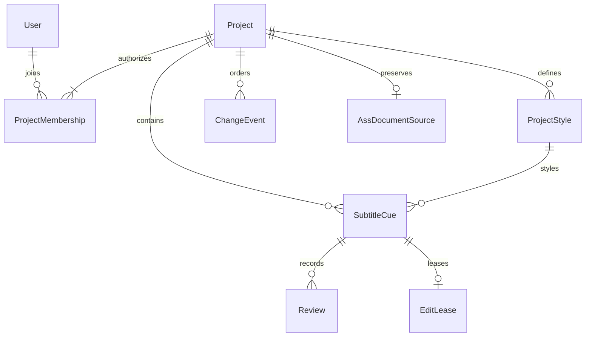
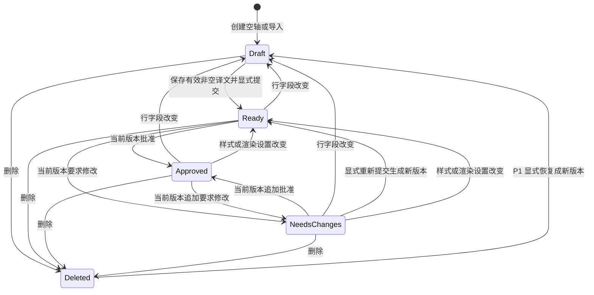

# 领域模型与工作流

状态：推荐设计基线，非 Django Model 定稿。硬约束集中在 [不变量](invariants.md)；传输与失败语义见 [实时协议](realtime-protocol.md)。

## 1. 聚合边界与实体职责

项目是协作、权限、时间基准、统一样式和持久变更顺序的边界。P0 每项目一个视频基准、一份共享 ASS 文档。以下是业务概念，不表示每个概念都必须独立建表。

| 概念 | 职责、关键数据与生命周期 |
| --- | --- |
| User | Django 身份体系的账号；项目权限来自成员关系，不把工种写进全局 User 类型 |
| Project | 名称、active/archived、不可变媒体基准、`project_seq`、`style_revision`；创建→协作→归档。归档只读且使所有租约失效，P0 不硬删除项目 |
| ProjectMembership | 唯一 `(project,user)`、能力集合；添加/调整/撤销都留痕。至少保留一名管理员，账号停用同样禁止访问 |
| MediaManifest | Project 内的值对象：完整 SHA-256、文件大小、时间原点约定和必要时长/分辨率；时长等是诊断信息。首次发布后不可替换，不保存路径或媒体字节 |
| ProjectStyle | 项目内稳定 ID、唯一 ASS 样式名、受支持的 v4+ 样式字段；行引用它。使用中的样式不可删除；P0 不改已引用样式名，允许改样式参数 |
| SubtitleCue | 稳定 ID、项目、开始/结束、原始 ASS 文本、样式 ID、Layer/Name/Margins 等已知字段、事件顺序、`cue_version`、`submitted_version`、软删除标记；空轴→草稿→提交→审核，可反复修改 |
| Review | 不可变审核决定：批准/要求修改、审核者、时间、可选理由、绑定版本元组；不保存成一个可随意覆盖的 `approved` 布尔值 |
| EditLease | 一行一个有效排他租约；服务端编辑会话、用户、不可猜测 token、过期时间。申请/续期/释放/撤销；不是修改历史，不以 Redis 为权威 |
| ChangeEvent | 一个成功持久命令对应一个项目序号，记录操作者、命令 ID、服务器时间、受影响 ID、前后值/版本及因果关系；状态与日志同事务提交，不用于重建全部数据库 |
| CommandReceipt | 成功命令的幂等回执：项目/用户/命令 ID、请求指纹、结果、可选项目序号；有变更时可与 ChangeEvent 同记录存储，no-op 仍需独立可查询的成功回执，不必另建通用命令框架 |
| AssDocumentSource | 成功导入时保留原始字节、编码/解析报告、已知注释/元数据与事件顺序；限定大小的字幕文本附件，不是视频存储；失败预检不持久化项目数据，原件继续留在用户本地 |
| Comment（P1） | 用户行评论；与 ASS `Comment:` 事件不同。绑定稳定行 ID 和上下文版本；行删除后保留在历史，拆分/合并不擅自搬移 |

MediaManifest、CommandReceipt 和未来 Comment 未全部画作独立表；外键布局在实现时再确定。Review/ChangeEvent 不因软删除而级联消失。ASS 注释事件不参与翻译、审核队列，但保留自身字段和事件次序。

## 2. 时间、标识与版本

- 项目创建是初始化事务：已认证创建者提交本地计算的媒体基准，服务器原子建立 Project、创建者管理员成员关系、默认样式及 seq=1 的创建事件/回执，style_revision 初始为 1；中途失败不暴露半个项目。之后所有项目操作遵循同一 Project 锁规则。
- 时间是相对同一媒体时间原点的非负整数毫秒；P0 持久值须为 10ms 的整数倍，对应 ASS 百分秒。界面捕获播放位置时明确吸附到此网格，若产生零长度则拒绝，不能悄悄拉长。`start < end`；允许行间重叠。超过报告时长先警告，不基于可能不准确的元数据截断内容。
- 行 ID 永不复用，显示行号不是 ID。时间列表按 `(start,end,event_order,id)` 排序；导出使用独立稳定的 `event_order` 保持 ASS 重叠/碰撞顺序，不能用界面时间排序擅自重排行文件。
- `cue_version` 从 1 起；每次真正改变行字段、显式提交、删除/恢复加一。无变化保存是 no-op，不增加版本。审核决定自身不改 cue_version，而是追加 Review 和 ChangeEvent。
- `submitted_version` 仅在显式提交时设为新 cue_version。任一后续行编辑使二者不等，自动回到草稿；不再额外存储容易漂移的“翻译已完成”布尔字段。
- `style_revision` 是项目全套样式和影响渲染的脚本设置版本；修改任一样式/这些设置递增一次。P0 保守使所有旧样式版本的审核失效，不逐行批量改版本。
- `project_seq` 对所有持久项目变更连续递增：行、审核、样式、成员、归档、导入、显式管理员撤锁审计等。一次导入或未来拆并影响多对象，也只占一个序号。失败/no-op/普通租约申请续期释放及过期/在线心跳不增加序号。序号是传输游标，不是所有行的编辑前置条件。

## 3. 权限

| 能力 | 可以执行 |
| --- | --- |
| view | 读项目字幕、允许展示的历史、ASS 下载；仅活动成员，非公开链接 |
| timing | 创建空轴，改时间；经版本与租约检查删除行 |
| translate | 改译文并提交翻译 |
| review | 对当前已提交版本批准或要求修改 |
| manage_styles | 新增/修改项目样式、渲染设置 |
| manage_project | 管理成员能力、归档、首次 ASS 导入、维护项目；不绕过业务约束 |

推荐预设：打轴=`view+timing`，翻译=`view+translate`，校对=`view+translate+review`（需改时间可追加 timing），管理员=全部。能力可叠加，管理员至少包含 view/manage_project；创建者初始拥有全部能力。P0 选择预定义样式要求 timing 或 translate，禁止跨项目样式引用；导入的已知辅助字段 P0 保留但不提供任意编辑。越权字段混在合法请求内也整体拒绝。

同一行所有内容修改、删除、提交和审核均需要有效整行租约；创建新行不需要先锁不存在的行，创建后也不自动长期占用，方便翻译立即接手。管理员没有无条件覆盖他人行的权限，可显式撤销租约并留审计，再正常取锁/比版本。成员撤销立即使其租约不可用。允许具备相应能力的作者自审，不隐含双人规则。

## 4. 提交与审核的派生状态

有效审核绑定 `(cue_id, cue_version, style_revision, media_sha256)`。服务器在同一事务中检查这些值仍是当前值、行未删除且当前翻译已提交，再记录决定。批准和要求修改都需要显式操作，不能由自动保存推断。

状态由以下优先规则计算，不同时存储这些状态字段：

1. 已软删除：Deleted，不出现在活动队列/导出。
2. 译文不满足可提交条件，或 `submitted_version != cue_version`：Draft。
3. 无当前绑定元组的 Review：Ready。
4. 当前绑定元组的最后一个决定为 approved/changes_requested：Approved/NeedsChanges。

可提交条件包括合法时间、有效项目样式、受支持的 ASS 语法和至少一个可显示非空白字符；不能只剥掉大括号后误判含绘图的行。无修改但要求重新提交时，显式 submit 仍生成新版本和历史；普通重复保存不会冒充重新提交。同一版本重复审核通过预期的 review-head ID 防止覆盖未知决定，详见协议。

内容或时间改变后历史 Review 原样保留，只是不再有效。样式改动不撤销翻译提交，因此回到 Ready 而非 Draft。P0 基准视频不能更换。相邻行改变不会自动改变本行状态；审核界面保留当时 project_seq 供上下文追查，但它不是整个项目的批准证明。

## 5. 日常流转与结构性操作

打轴创建空轴后立即让出该行；翻译在停输后保存，并在完成一行时提交、释放锁；校对取锁后通看上下文，决定或先修改。校对修改会使旧提交失效，必须重新提交才可批准。可提供一次按钮组合多个明确步骤，但服务端语义必须原子或逐步显示，不能显示中途已审核。

删除必须确认当前 cue_version 和租约；已批准行也可按权限删除，但必须留痕。持有旧版本的客户端收到删除后保留本地草稿为冲突材料，不自动复活行。

| 操作 | 计划语义 |
| --- | --- |
| 拆分（P1） | 一事务锁定源行及项目；软删除源行，生成新 ID 的两个 Draft；显式选时间切点与文本分配，不能猜测翻译切分；样式/允许元数据继承，审核不继承 |
| 合并（P1） | 确认所有源行当前版本及租约；一个事务软删除源行、生成新 Draft；明确时间区间、文本连接、样式选择，冲突字段由用户确认 |
| 评论/来源关联（P1） | 原行历史保留；新行记录 `derived_from`，界面可追溯来源；旧评论不伪装成针对新文本的审核，需人工重新关联 |
| 历史恢复（P1） | 将选定历史内容作为当前新版本写入，正常鉴权/取锁/比版本、追加日志；不回拨 project_seq/cue_version，不复活旧审核，不覆盖后来其他行修改 |

当前只设计这些后续规则，不在 P0 暗中增加拆并命令或通用事件重放框架。P0 历史只读，故障恢复依赖数据库备份和管理员调查。

## 6. ASS 可编辑契约与保护策略

这是产品承诺的兼容性边界，不等于底层渲染器宣称能显示的全部功能。

| 内容 | P0 计划 |
| --- | --- |
| 文件 | UTF-8（可含 BOM）的 ASS v4+；按文件 `Format:` 映射字段，Text 内逗号不得被错误拆分；导出 UTF-8、明确换行与小数点格式 |
| 样式/脚本设置 | 支持标准 v4+ 样式字段、PlayResX/Y、WrapStyle、ScaledBorderAndShadow、YCbCr Matrix；有效值与默认值需有样例测试；样式名唯一，引用必须能解析 |
| Dialogue | 时间、Text、Style 可编辑；Layer、Name、MarginL/R/V 等已知字段保留，P0 只读；非空 Effect 进入保护性路径 |
| 文本 | 普通中文/Unicode，`\N` 强制换行、`\n` 软换行、`\h` 空格及 `\b0/1`、`\i0/1`、`\u0/1`、`\s0/1`；支持组合标签块，准确保留语义，不转换成 HTML |
| 注释/元数据 | 已知 `Comment:` 事件、分号注释、Script Info 非执行性键值保留并维持锚点/顺序；路径/URL 只作文本，绝不自动读取/请求 |
| 保护性内容 | 未知 section/字段/tag、SSA 旧格式、绘图/卡拉 OK/动画、局部字体/颜色/位置覆写、附件 Fonts/Graphics、错误语法/编码、无法安全分类的记录：整份文件不进入可编辑导入 |

导入分“预检→报告→管理员确认→原子提交”，只允许空项目，预检记录绑定原始文件摘要和预期 project_seq/style_revision。报告列出文件/行号/原因，不悄悄删除标签、映射缺失样式或导入半份文件。支持的注释字段也要验证其结构；未知标签出现在注释中同样走保护性路径，避免绕过导出边界。

保护性路径只允许原始文本检查、兼容性报告与从本地选中 File 重新下载原件，不持久化被拒文件，也不承诺可视预览；不能通过一次“继续”破坏内容后伪装为保真导入。预检文件可通过有界请求在服务器解析，失败后不保存副本；成功导入时才将 AssDocumentSource 和业务数据一同提交，后续原件下载走成员授权。用户若另行简化文件，应保留原件并作为新输入重新预检。解析器选型必须经过 [S3](milestones.md)，不能假设第三方对象模型天然保留所有未知数据。

“保真”分两种：原件下载须字节相同；受支持子集的编辑导出须语义等价并保留规定的非编辑数据，但不承诺空白、BOM、格式化逐字节一致。导出必须从单一项目快照生成，不能混入不同时间的样式和行。Text 新增不支持标签也必须在保存时拒绝；有能力渲染复杂 ASS 不意味着有能力安全编辑它。
