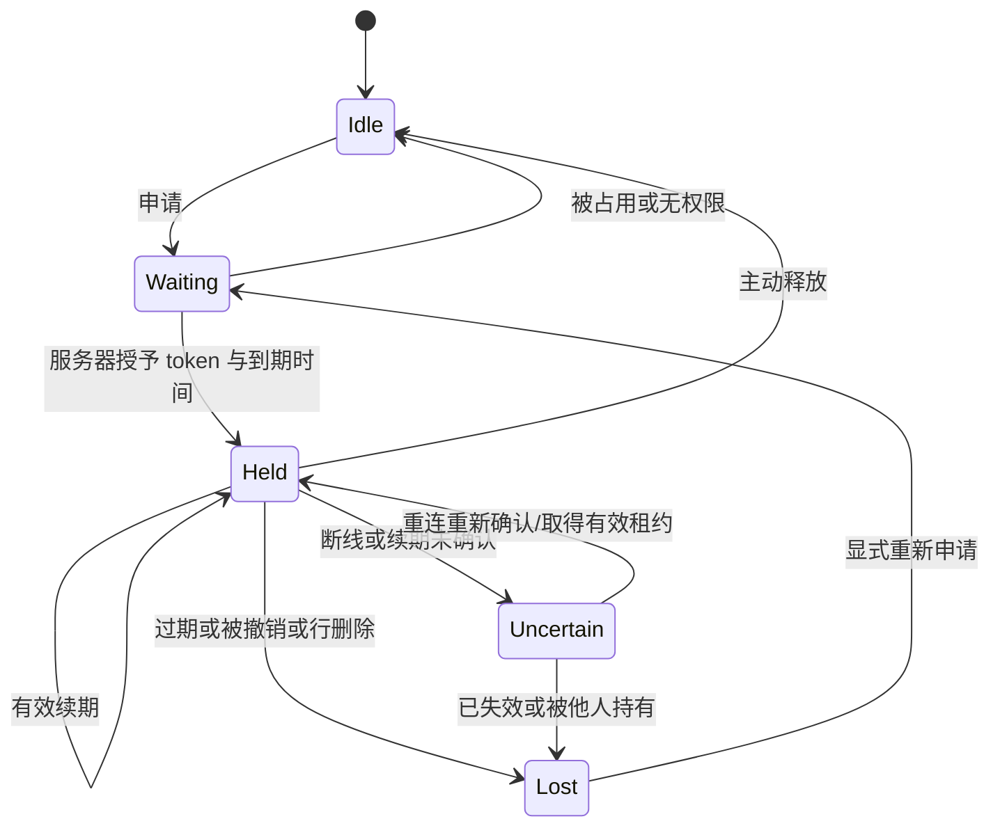

# 实时协作协议设计

状态：语义基线，字段名称是示意，最终 JSON Schema 与 URL 在实现切片中确定。版本含义以 [领域模型](domain-model.md) 为准；业务约束见 [不变量](invariants.md)。协议版本独立于 project_seq/cue_version，不兼容的客户端必须提示升级，不能猜测解析。

## 1. HTTP 与 WebSocket 的职责

| 通道 | 责任 | 不承担 |
| --- | --- | --- |
| HTTP | 登录/成员管理、所有持久业务命令、命令结果查询、一致快照、事件重放、水位核对、ASS 预检/导入/导出 | 视频传输、广播未提交草稿 |
| WS | 连接/订阅、已提交事件、在线提示、租约申请/续期/释放、周期水位/权限核查 | 另写一套持久业务规则、靠连接存在保证持久保存 |

有意推荐“HTTP 写 + WS 推”，便于超时重试和调试；实时性取决于提交后的立即通知，不要求所有写入也走 WS。租约走 WS 便于关联编辑会话，但必须调用 projects 公共接口；必要的 HTTP 租约回退也只能调用同一实现，P0 不要求双份端点。

握手认证后，为当前浏览器标签页建立服务端可验证的编辑会话身份；同一用户的两个标签页是不同会话。会话不是权限缓存。订阅、每个命令、每次读取/发送都重新检查当前身份和项目权限。跨项目订阅拒绝；会话失效/撤权时停止发送并关闭，客户端清除共享副本，未提交草稿仅提供明确授权下的本地处置。

## 2. 消息类别与最小语义

| 类别（示意） | 最小信息与处理 |
| --- | --- |
| `hello / subscribed` | 协议版本、项目、编辑会话、服务端时间、当前高水位；没有完整快照不能直接开始编辑 |
| `project.event` | 项目、project_seq、命令 ID、事件类型、受影响对象及版本、可安全分发的提交后值/墓碑；一个序号是不可分割的应用单元 |
| `project.watermark` | 当前持久序号与服务器时间；不增加序号；用于发现最后一条通知丢失 |
| `lease.request / renew / release` | 请求关联 ID、行、编辑会话、当前 token（续期/释放时）；响应是授予/拒绝、当前行版本、到期时间或原因 |
| `lease.changed` | 行、占用者显示信息、到期提示；不携带 token，不进入持久序列；丢失后可重查 |
| `presence` | 在线/离线/正在看或编辑某行的提示；仅建议性，不参与权限、审核或锁有效性判断 |
| `resync_required / access_revoked / error` | 稳定错误代码、请求关联 ID、恢复方式；不向未授权成员泄露字幕或他人租约凭证 |

持久命令的 HTTP 请求至少含：项目、认证用户隐含身份、唯一 command_id、命令类型、受影响对象、预期版本与载荷；现有行命令还含编辑会话/租约 token。审核另含客户端看到的 style_revision、媒体摘要、review-head ID；样式修改含预期 style_revision，成员/归档/导入等项目级命令含预期 project_seq。

字幕文本自动保存只检查本行版本，不要求 project_seq 等于最新，避免另一个人编辑其他行导致无意义冲突。所有前置条件仍在同一事务重新验证；create/保存需要的有效样式引用与项目状态不能仅信任客户端。

## 3. 原子提交与幂等

现有项目持久命令的处理顺序如下；项目创建使用 [领域模型](domain-model.md) 定义的原子初始化事务，创建回执按用户与 command_id 去重，重试必须返回原 project_id，不能创建第二份项目。

1. 验证请求结构/大小，开始短事务并锁 Project；确认当前活动成员和项目查看权限。
2. 查询 `(project,user,command_id)` 成功回执；同请求指纹返回原结果，不再检验旧租约。相同 ID 不同请求返回 `COMMAND_ID_REUSED`。
3. 对新命令检查当前操作能力、项目可写、行归属/未删除、预期版本、有效租约、可写字段和命令特有约束。审核还比对当前绑定版本元组的 review-head（没有则为 null），防止覆盖未知的审核决定。
4. 修改业务状态、分配下一个 project_seq、追加 ChangeEvent 和成功回执，同一事务提交。失败全部回滚；纯 no-op 仍保存无新序号的成功回执，以便之后重试返回同一结果。
5. 提交后返回 success：command_id、project_seq（若有变更）、权威行/样式版本、规范化值。尝试广播失败只影响推送状态，不将已提交数据报告为失败。

HTTP 响应和 WS echo 可能任意先后到达。成功回执确认的是该命令对应的草稿代次，不能把后续输入也标成已保存。自身命令的 seq=42 不允许把连续游标从 40 直接跳到 42；41 仍须补齐。echo 也不再次执行命令。

网络超时/连接中断属于 `outcome_unknown`：先查命令状态，或用原 ID 与完全相同载荷重试。不得为未知结果随意生成新 ID。未找到回执时旧请求可能仍在执行；相同 ID 的重试在 Project 锁下串行解析，不会双写。确认冲突后用户基于新版本重新操作，使用新 ID；不能把改变后的载荷塞进旧 ID。

Alpha 保留全部成功回执/幂等键，不用 Redis 缓存或短 TTL 作为唯一去重依据。不承诺网络恰好一次送达，只保证持久命令在此保留边界内至多一次生效。失败请求不作为已成功回执；客户端仍应固定载荷重试，避免含糊语义。

### 未决命令的跨刷新恢复

发送任何可能产生持久效果的命令前，project-data 必须先持久化最小未决记录：所属用户、项目或创建操作的本地目标标识、command_id、命令类型、冻结请求及预期版本，以及可选的 draft_id/草稿代次。创建项目时尚无 project_id，创建空轴时尚无 cue_id，仍须能通过本地目标找到原命令。记录未成功落盘则不发送，提示故障并保留可复制/下载的草稿；这不是离线任务队列，不自动执行断网期间积累的新操作。

冻结请求包含原编辑会话/租约凭证；认证 cookie、CSRF 凭证不作为业务载荷保存，查询和重试仍使用当前认证并校验原用户权限。记录及其中的短期凭证仅在该用户的本地恢复存储中使用，不进入日志、事件或草稿导出。需要附件的命令必须能重建相同输入；若需重新选取文件，先核对其摘要，不能改用另一文件重试原 ID。

刷新/崩溃重开后，先认证并核对服务器状态，枚举本用户的未决记录，再处理对应草稿和依赖操作：

1. 查到成功回执：确认原 command_id 和原草稿代次，记录创建出的对象 ID；确认代次的更新、清理判断与未决记录终结在同一本地存储事务内完成。清理前再次崩溃也可重复查询，不重新创建对象。
2. 未查到回执：仍是未知结果，原请求可能尚未执行。不能生成替代 ID；在原前置条件仍有效时，可恢复原 ID、完全相同请求的重试。无租约的项目/空轴创建同样沿用原 ID，不凭相同时间或文本猜测是否创建成功。
3. 原编辑会话或租约已失效：先查原回执，不换 token 或载荷重试原 ID。只有服务器在与执行相同的项目锁内确认无成功回执、且原请求已不可能再通过前置条件（如旧 token 已永久失效）时，才能认定未生效；随后用户可基于最新版本重新取锁，以新 ID 发起新操作。无法确认就保留未知记录，不阻止其他独立行的工作。

已终结命令的重复 ACK 只能幂等确认原记录，不能回退已应用的服务器版本或清理后续输入。以上恢复规则适用于同一数据库历史；备份恢复后的历史识别采用第 6 节已确认的恢复代号方案，不能据此允许跨历史自动重试。

## 4. 行租约

推荐整行排他，覆盖时间、文本、删除、提交与审核。字段级锁虽然可让同一行同时改轴和译文，但会引入组合审核、拆并、多字段保存的复杂性；P0 先通过处理不同的行形成流水线。

推荐参数（S4 校准）：TTL 45 秒、每 15 秒续期、每标签页最多主动编辑一行。用服务器时钟，在取得事务锁之后判断有效期；前端倒计时只是提示。后台标签页计时器可能暂停，客户端不能假设租约仍有效。

申请在 PostgreSQL 中原子地判断空闲/已过期并生成新 token。重复的当前会话申请可以返回自己仍有效的租约，不为同用户另一个标签页隐式抢锁。到期后重新申请必须换 token；过期 token 不得续期或释放后来新租约。保存/审核执行时独立比对 token、会话、用户、有效期和 cue_version；不是拿到锁就免检版本。

切行时先完成已排队保存或明确保留草稿，再释放旧锁。断开连接可尽力释放，但正确性依靠 TTL；不要依赖 disconnect 回调必达。重连不自动恢复写权限，先重新确认/取得租约、读取最新行版本，再处理草稿。服务器租约重查与界面占用快照可独立恢复，不占 project_seq。

管理员显式撤销租约需 manage_project、原因和持久审计事件，但不能顺便覆盖行；随后按正常流程取锁。自动过期与普通续期不写永久历史。撤权/归档后旧 token 即使未过时也无效。

## 5. 自动保存与提交

客户端区分：`clean → dirty → saving → saved`，并有 `invalid`、`outcome_unknown`、`conflict`、`lease_lost`、`offline`。这些是客户端交互状态，不写进字幕领域状态。

- 输入先进入 IndexedDB 中的本地草稿，记录独立 draft_id、来源编辑实例、基准 cue_version、递增草稿代次和内容；同一用户/项目/行可以有多份草稿，不以这三个字段覆盖单份记录。未创建对象使用本地临时目标标识。draft_id 不随 WS 重连或 token 更新而改变，也不等同于服务端编辑会话 ID。
- 每个页面只写自己的草稿；新标签页不自动接管旧记录。刷新后原记录及身份保留，先处理其未决命令，再展示多个恢复候选；用户选取后复制为当前实例的新草稿，原记录只按确认或明确人工清理规则处理，避免两个页面共同改同一记录。存储失败可见并提供复制/下载草稿。
- 退出账号清理共享缓存及内存中的租约凭证；未决记录与草稿的保留/删除应一并明确提示，不自动发送，也不向下一个账号展示。用户选择删除本地恢复材料时提示将失去未知命令的查询关联，不能把删除材料当作服务器操作已取消。
- 暂定 500ms 停输保存、持续输入时最多约 2 秒提交一次最新有效快照，同一行最多一个未决请求。每个请求冻结载荷；在途期间继续输入形成更高草稿代次。
- ACK 仅确认请求绑定的 draft_id/代次；记录含更高代次内容时不得删除，只推进已确认代次。禁止按用户/项目/行批量清理其他草稿。若有新输入再以确认后的版本发下一次保存，不能丢弃在途期间的输入。非法时间/标签保留在本地并明确报错，不写坏共享状态。
- 翻译“提交”先等待此前保存结果明确，再执行 submit；或以一个明确定义的 save-and-submit 原子命令提交当前完整合法草稿。P0 推荐先采用前者，提交成功后释放锁供校对接手。
- review 前必须拿到最新已提交行，携带 expected_cue_version/style_revision/media_sha256/review-head。任何比较失败都要求重新检查，不能自动批准更新后的内容。
- 行变更、删除、租约失效或版本冲突时不做 last-write-wins、不无提示自动合并。展示“你的草稿/服务器当前版本/基准版本”，可复制差异、重新取锁后人工重做，或放弃草稿。

本地草稿不是服务端备份；刷新后先同步权威版本再展示草稿恢复入口。已保存但未提交翻译的行仍是 Draft，自动保存和进入待校对是不同操作。

## 6. 有序事件、快照与重放

客户端保存最后连续应用的 `last_applied_seq`：收到 next=last+1 才应用；重复/旧消息忽略；更大的序号有界缓存并请求缺口。不同项目游标不能混用。事件对多行的影响必须原子应用，不能渲染出一半导入、一半旧状态。

订阅/重连流程：

1. 认证并先订阅项目 WS，开始缓冲通知；立即重新核验成员权限。后续快照/重放同样鉴权。
2. 新会话取得一致快照及序号 S；已有完整缓存可从 last_applied_seq 请求重放，缓存不完整时必须快照。
3. 重放读取固定高水位 H，返回 `(S,H]` 的连续事件页；每页标明实际范围与 H，不能因权限投影而无提示跳号。无权查看的事件细节可脱敏成同序号的安全失效通知；已经无权查看项目则直接拒绝。
4. 应用快照 S，按序应用到 H，再排空订阅期间缓冲的 >H 事件；S 以前的事件忽略。此流程覆盖读快照/订阅交界处的写入，不能只“读一次快照后开始监听”。
5. 重放窗口过旧、缓冲超限、缺失事件或协议不兼容时返回 `resync_required`，丢弃不完整共享副本并取新快照；本地草稿单独保留。

P0 快照不对活动数据做跨时点分页；项目总量受明确上限约束。未来分页必须绑定快照版本。重放页也不能在读取中追逐不断增长的 H。大批量导入事件可以仅发送“必须获取至少 seq=N 的完整快照”的屏障，客户端不得跳过屏障后接着应用旧副本；历史仍保留原子变更细节。

### 已确认、延后实现：数据库恢复后的历史边界

以上游标/版本比较以同一数据库历史为前提，仅比较 project_seq 不能识别备份恢复后的不同历史。[D-R1](decisions/0001-initial-architecture.md#d-r1) 已选择 A：显式恢复代号，使旧缓存、会话及未决命令不能直接沿用到新历史。实现推迟到相关恢复机制开发阶段；本轮不增加字段或设计切换细节，也不阻碍首个播放/打轴/ASS 验证任务。

### 尾消息丢失与广播故障

只检测序号缺口不足以发现最后一条事件丢失。推荐活跃 WS 每 5 秒独立查询数据库水位/权限并发送 watermark；浏览器每 5 秒通过轻量 HTTP 校验水位/权限，不能以“WS 看起来还连着”为由取消检查。目标是活跃窗口在 10 秒内发现静默落后；休眠窗口在重新可见/联网时立即核验。多连接轮询开销通过 S4 评估后合并，不能改变语义。

数据库提交后、广播前进程崩溃，或 Redis 丢通知，仍能由持久 ChangeEvent 补齐。Redis 故障时显示实时服务降级：HTTP 保存确认仍有效，但暂停新租约编辑，允许保留草稿；恢复订阅/校验后再继续。PostgreSQL 不可用则不能确认保存或续期，不允许缓存里假成功。

## 7. 错误与恢复矩阵

| 结果 | 典型情况 | 客户端动作 |
| --- | --- | --- |
| `VALIDATION_FAILED` | 时间/ASS 标签/样式引用不合法 | 保留草稿，定位字段；改正后新命令 |
| `VERSION_CONFLICT` | 旧行版本或样式/审核头改变 | 停止自动覆盖，读取新值并人工复核 |
| `LEASE_DENIED / LEASE_EXPIRED` | 他人占用、过期或会话不符 | 退出写入状态、保留草稿，显式重取锁 |
| `CUE_DELETED` | 在旧页面保存被删除行 | 保留可复制草稿，不自动重建 |
| `FORBIDDEN / SESSION_EXPIRED` | 撤权/会话失效 | 停止项目读写并关闭订阅，重新认证不自动重放草稿 |
| `PRECONDITION_FAILED` | 非空项目导入、项目已归档等 | 重新获取上下文，解释操作条件 |
| `COMMAND_ID_REUSED` | 不同载荷复用 ID | 视作客户端错误；查原请求，不能盲目重试 |
| `RATE_LIMITED / TEMPORARILY_UNAVAILABLE` | 请求过快或数据库短暂失败 | 有界退避；先确认命令结果，恢复前保留草稿 |
| 网络超时/未知 5xx | 可能提交后响应失败 | 标为 outcome_unknown，查回执或用原命令原载荷重试 |
| `RESYNC_REQUIRED` | 历史窗口不足、缓冲超限、事件缺失 | 取一致快照；单独恢复本地草稿 |

HTTP 状态码是承载方式，不代替以上业务代码。错误信息包含稳定可测试的原因及关联 ID，不包含敏感 token。服务器时间用 UTC，客户端可本地化显示；租约到期不依赖客户端时区。

## 8. 协议验证重点

必须覆盖：三浏览器流水线；不同会话抢同一行；旧 token 迟到保存；提交成功但 ACK 丢失；echo 先于 ACK；自身 ACK 前存在其他人的序号；乱序/重复/尾事件丢失；快照时持续写入；样式修改同时批准；成员撤权时持续发送；Redis/应用进程重启；本地配额失败；中文输入法与保存/快捷键竞争。

新增恢复反例：同账号双标签页中 A 断网留草稿、租约到期后 B 编辑保存，再刷新两页，恢复候选不得互相覆盖/清理；旧 ACK 不得删除更高草稿代次。项目创建、空轴创建和行保存分别在“记录后未发送／服务端提交但未收到确认／收到确认但未清理”处强制关闭页面，重开后无重复效果且保留在途新输入；未决记录落盘失败不得发送命令。备份恢复后新历史达到旧游标相同及更大序号的案例，在恢复机制开发阶段按 D-R1 的恢复代号方案验证。测试落点及门槛见 [S4 与 M1/M2/M4](milestones.md)。
