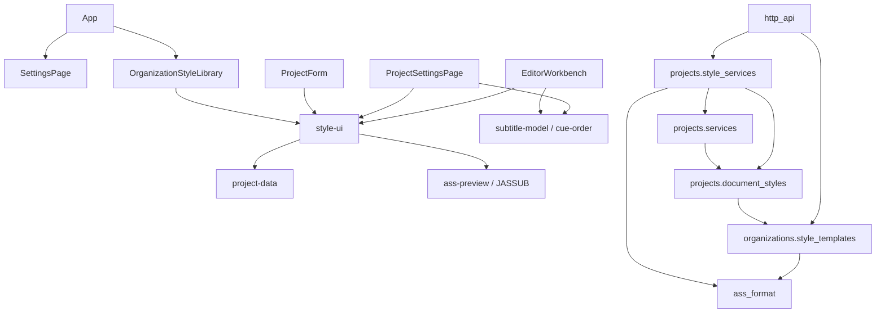

# 样式管理（已确认 A 阶段）

2026-10-24：已实现组织模板、项目样式快照、稳定引用、管理界面及本地实时预览。用户已选择 A：先交付样式功能，公共多人协作与完整历史另行实施。现有项目仍显式保存/重载，以整个项目 revision 检查冲突；没有 WS、ChangeEvent、审核或租约。

## 用户入口与保存语义

- 组织设置页的「组织样式库」：所有活动成员可查看/搜索/预览；organizer/dev 创建、编辑、删除模板，或通过 ASS 预检提取样式。来源说明可编辑，仅作文字，不读取路径/URL。
- 新建项目的「样式模板与脚本设置」：可选择多个模板及导入名称、copy/scale，并设置项目 ASS PlayRes；与项目/媒体初始化同一事务，任何一项失败不留下项目。
- 项目设置的「项目样式 → 管理项目样式」：查看/搜索/创建/编辑/复制、使用数、未使用样式删除、按字段勾选批量编辑、为多条字幕分配样式、组织模板导入及另存模板、脚本设置。项目工作区顶部不再提供入口；设置页不要求视频。
- 「从组织导入」支持一次勾选多个模板，分别设置导入名称与 copy/scale，点击「应用并保存」以单次请求原子保存整批，项目 revision 只增加一次。任一模板版本过期、跨组织、重名或缩放失败时整批不保存，保留当前选择与输入；成功后清空选择并展示最后导入的样式。
- 项目 member/organizer/dev 的样式操作都要求可写项目和当前 revision。按钮「应用并保存」使用设置页加载的已保存字幕快照，不读取或提交工作区的未保存字幕/时间草稿。元数据与样式共用设置页的文档和 revision 基准，名称/说明草稿独立保留；失败、归档、权限错误与 409 不替换文档或表单。已打开的工作区保持原文档/revision，旧版本保存冲突，显式重载后才采用新样式。使用中的样式和最后一个样式不能删除，Comment 使用单独显示并参与保护。
- 本地工作区复用无持久副作用的样式转换接口，需要导出保存；组织模板导入在项目内进行。管理器表单效果预览不表示已应用/已保存。

## 所有权与数据契约

`organizations.OrganizationStyleTemplate` 是新增表；`projects.Project.document` 继续持有所有项目样式和 Cue，不增加平行持久化表。

```text
document = {
  schema_version: 2,
  source: 原始 ASS 文本/锚点模板,
  script: {play_res_x, play_res_y, scaled_border_and_shadow},
  styles: [{id: UUID, name, fields: 标准 ASS 属性字符串字典,
            source_name: 原始样式名或 null,
            origin: {template_id: UUID, revision} 或 null}],
  cues: [{id, start_ms, end_ms, text, style_id, source_id?}]
}
```

源文本继续保存分号注释、Script Info、事件辅助字段及顺序；结构化 styles/script 是当前渲染权威。source_name 仅是原始样式/Comment 的绑定，改名不改绑定。序列化按原 Format 覆盖记录，不通过重新导入重排行号；改名后 Dialogue 和 Comment 导出引用当前名称。ASS 本身不保存内部 UUID，重新导入会生成独立身份。

模板导入生成新项目 UUID，复制受支持字段并记录模板 ID/当时 revision。项目修改、模板修改/删除互不传播；来源关系没有 FK 级联或动态继承。模板自身 revision 与项目整体 revision 分开，均在事务锁下比较。模板名称组织内唯一，样式名称项目内唯一。

普通文档保存/拆分必须保持 source/styles/script 与权威基准相同。新增/复制/删除/批量修改/模板来源只能由具名样式操作生成，不能通过伪造文档将其他项目 UUID 或来源混进保存。所有纯操作先验证完整输入，再构造新对象、验证最终输出；批量操作整批成功或失败。

## 模块与依赖



账号 SettingsPage 只接收 ReactNode 插槽，不导入样式模块。ProjectSettingsPage 负责项目样式，EditorWorkbench 仅组合本地样式管理器；StyleUI 接收上层按 subtitle-model/cue-order 排序后的 Cue，不访问工作区内部。后端遵守 User → Organization → Project / Template 锁顺序，在组织锁下重新鉴权。projects 不读取模板私有 ORM；只调用公开快照函数。ass_format 无 Django/ORM/网络依赖。协议/锁/审核不为样式另建一套机制。

## HTTP 接口

全部持久写入口沿用 Session、CSRF、账号一致性头和服务端固定角色检查；字段严格白名单。

| 接口 | 输入/结果 |
| --- | --- |
| GET `/api/organizations/{org}/style-templates` | `{templates}`；同组织当前成员/dev 可读 |
| POST 同路径 | `{name, fields, reference, source_label}` → `{template}`；organizer/dev |
| PUT `/api/organizations/{org}/style-templates/{uuid}` | 同上加 `revision`；返回新模板，旧版本 409 |
| DELETE 同路径 | `{revision}`；不影响已导入副本 |
| POST `/api/organizations/{org}/projects/{project}/styles` | `{revision, document, operation}` → `{project: summary, document, usage}` |
| POST 项目列表创建 | 既有字段加可选 `script` / `style_imports`；创建结果仍是完整项目 |
| POST `/api/ass/styles` | `{document, operation}` → `{document, usage}`；纯转换，不读身份/数据库，与既有 ASS 接口一样公开 |

具名 operation：

| type | 其他字段 |
| --- | --- |
| create | name、完整 fields |
| update / copy | id、name、fields 属性补丁；copy 生成新 UUID |
| batch | 唯一 ids 数组、非空 fields 补丁；不接受 Name/身份/来源字段 |
| delete | 唯一 ids 数组；不得删除使用中/最后一个样式 |
| assign | 唯一 cue_ids、style_id；全部属于同一项目文档 |
| script | 完整 script；不自动缩放既有样式 |
| import（仅项目） | template_id、revision、name、mode；组织归属和版本由服务端读取检查 |
| import_many（仅项目） | 非空 imports 数组，至多 1000 项，每项为完整 import 操作；整批原子提交，复用创建项目的模板校验与快照转换 |
| inspect（仅纯转换） | 无其他字段；返回 Dialogue/Comment 分开计数，不修改文档 |

`style_imports` 是 import 操作数组。`usage` 为 `{[style_id]: {cues, comments}}`。非法 ASS/样式 422，请求结构 400，无权限 403，错误资源/跨组织对象 404，项目/模板旧版本或归档 409。模板/项目 no-op 不递增 revision。网络响应丢失时结果可能未知，保留输入并显式重载核对；当前没有幂等回执或自动重试，不把网络失败当作事务未提交的证明。

## PlayRes、字体与 ASS 边界

- 保留实际视频像素与 ASS PlayRes 的区别；选片不修改样式/脚本。源缺失 PlayRes 可以保真保存为 null，但 scale 和模板保存要求完整参考设置。
- copy 原样复制；scale 只支持完整且同宽高比的源/目标，且双方 ScaledBorderAndShadow=yes。
- 比例为目标 PlayResY / 参考 PlayResY，转换字号、字距、描边、阴影和样式三边距。Decimal 运算，边距 half-up 到整数，其余几何字段 half-up 到六位小数，超出有效范围整次拒绝。
- 不转换颜色/透明度、字体/布尔、ScaleX/Y 百分比、角度、BorderStyle、对齐与 Encoding。不修改字幕行的边距覆写。异宽高比、未知脚本设置或边框缩放不兼容要求 copy 后人工调整。
- 名称/字体 1–100 字符，禁止逗号/控制字符/首尾空白；颜色完整 `&HAABBGGRR`；PlayRes 1–32768；每项目 1–1000 样式、每组织至多 1000 模板，并沿用 1MiB / 5000 事件及现有文本/时间上限。重复 PlayRes（含大小写变体）或非法值保护性拒绝。
- 复用既有 JASSUB、同源 Noto Sans SC fallback 与替代提示；不扫描/上传系统字体，不自动访问在线字体。样式样本使用本地 Canvas 流，关闭面板释放轨道/引擎。
- ASS 支持范围未扩展：未知字段/section、附件、动画/卡拉 OK/绘图/局部覆写继续拒绝。标准 Style/Script/Dialogue/Comment 及已支持辅助字段保持语义往返，不承诺原件字节相同。
- 当前没有翻译提交/内容审核/视觉 QC 实体。已更新未来约束：样式变化只要求视觉 QC 重新检查，保留内容审核事实与翻译提交；不创建假审核状态。

## 升级与恢复

1. 在旧版本停止写入前，让用户应用时间输入并导出所需本地稿件；旧页面升级后不能向 v2 服务写入或继续以旧契约导出。
2. 备份 PostgreSQL，停止旧版本写入进程；在维护窗口运行 `python backend/manage.py migrate`，应用 organizations.0002 与 projects.0002。
3. 模板迁移建表；项目数据迁移一次性生成并持久化样式 UUID，保留 source、Cue ID/source_id、媒体、revision、操作者与时间。任何异常文档报告项目 ID 并整体中止回滚，不能跳过。需先调查/修正不符合支持边界的旧快照。
4. 同步部署前后端并重启后端，刷新客户端。混用旧契约明确报升级错误；不以名称猜测映射。现有运行的开发后端也需重启；2026-10-24 实现阶段未操作开发数据库，2026-10-25 经用户授权启用，见下节记录。
5. v2 包含新定义/ID/来源，不能无损回退为旧名称数组；RunPython 故意不可逆。回滚需部署前备份，迁移后的新编辑先单独导出保留。

## 已执行验证

2026-10-26，现有项目批量模板导入：

- `.venv/bin/python backend/manage.py test projects.test_styles projects.tests ass_format --noinput`（先加载 `.env`）：47 项通过，使用独立 PostgreSQL 测试库。新增覆盖多模板 copy/scale、独立 UUID/来源、member 权限、一次 revision、重名/过期/跨组织/适配失败整批不保存、无效载荷、旧项目版本及归档保护。
- `npm run test:style-management`：Chrome 回归通过，验证双选可提交、单次请求/版本、混合复制/缩放、重名和过期失败保留输入、刷新与成功清空选择，以及既有样式操作、工作区草稿隔离、模板库和创建项目。
- `npm run typecheck`、`npm run test -- --run`（269 项）、`npm run build`、`git diff --check` 均通过。模块依赖方向未变化；无数据库迁移。

2026-10-24，真实 PostgreSQL 隔离测试库 `test_cuerelay_style_checks`，测试结束删除；未写开发库。

- 后端全套：`PGDATABASE=cuerelay_style_checks .venv/bin/python backend/manage.py test accounts ass_format http_api organizations projects --noinput --verbosity 1`：101 项通过，system check 无问题。包含权限/CSRF、跨组织/项目、版本冲突、真实多连接竞争、写入后故障回滚、既有快照迁移与整体回滚、格式/Comment/元数据保留和适配边界。
- 静态检查：`makemigrations --check --dry-run --noinput` 无遗漏迁移；针对本地导入的静态扫描包含前端类型导入，74 个前端源模块/212 条边、39 个后端源模块/66 条边，均无环；style-ui 不导入其工作区消费者，ass_format 无 ORM/HTTP 依赖；`git diff --check` 通过。
- 前端：`npm run typecheck`、`npm run test -- --run`：260 项通过；`npm run build` 通过。
- `npm run test:style-management`：真实 Chrome 147 / JASSUB / WASM 与真实纯 codec，身份/项目接口为无数据库 HTTP 夹具。复制/颜色、勾选字段批改、批量指定与改名稳定引用、失败/冲突保留表单/字幕/时间草稿、模板 CRUD/来源/独立快照、新建项目模板、PlayRes、删除保护、ASS 导出、桌面/390px 布局通过；实际像素验证红色样本，输入复用同一 canvas；无页面异常或外部网络请求。截图和 result.json 输出系统临时目录。
- 既有字幕表格、通用编辑/项目拆分、项目设置浏览器回归通过。编辑回归需 `EDITING_URL=http://127.0.0.1:5173/workspace/local`；首次误传列表地址的运行已纠正重跑。
- 既有 `ass-preview.mjs` 在隔离 Django HTTP 服务 + Vite 上通过，避免使用尚未重启的旧开发服务；真实中文/多样式/改色/播放/字幕时间草稿/布局/全屏/错误恢复/显式远端重载通过。首次连旧契约服务的运行不计为通过；切换隔离服务后重跑通过。

未声称验证真实成员制作流程、跨平台字体一致性、多人推送或不可变历史。任务原验收 1–13 由本切片相关测试覆盖，14（实时协作客户端收更新）按 A 明确延期；其他成员目前使用显式重载。后续应实现已设计的通用协作/历史公共设施，再接入本模块，而不是新增样式专属轮询/日志。


## 本地启用记录（2026-10-25）

用户明确说明当前测试数据无需备份，授权直接迁移并重启。已停止旧开发服务、不做备份，成功应用 organizations.0002_organizationstyletemplate 与 projects.0002_document_styles_v2；migrate --check 无待执行迁移，Django system check 无问题，既有项目文档均为 schema v2，组织模板表可查询。

后端重新运行于 127.0.0.1:8000，前端重新运行于 127.0.0.1:5173。前端首页 HTTP 200；直连后端及经前端代理的 v2 空文档、无持久化样式复制和 ASS 导出检查均通过。该检查没有新增项目或模板。已有浏览器页面需刷新以接纳新版本。

2026-10-26 批量导入运行修正：原开发后端以 `runserver --noreload` 运行，前端更新后仍由旧后端处理 `import_many`，返回「未知样式操作」。已重启本机 8000 服务，移除 `--noreload` 并确认 StatReloader 启用，经 5173 代理的会话接口 HTTP 200。代码/测试通过不等于既有服务已加载新代码；后端禁用自动重载时，新增操作必须同步重启服务。
